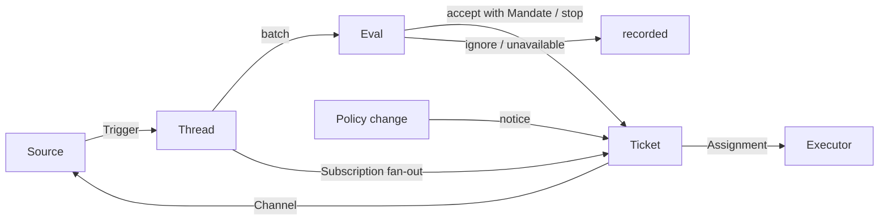

# 001 领域模型

本文为 dsh-superagent 的各个概念命名，并说明每个概念各自遵守的规则。代码、智能体调用的工具、面板以及其他文档都只使用这些术语，不再另用别的说法。承接 [000 理念](000-philosophy.md)，本模型只保留工作真正需要的概念，而一个业务需求会变成其中某一个概念的属性。

## 流程

工作从触发器流转到评估，再到执行。一个 Source 产生触发器。一个触发器以上下文的形式扇出到订阅了它所属会话线程的那些工单上。以这种方式抵达某个工单的人的留言，会一直留在那个工单上；其他所有触发器都进入评估，由评估决定是否为它询问新工作。当评估接受时，它创建一个带有授权的工单。一次派工把工单交给一个执行器，结果则通过渠道回到 Source。

## 概念

Source、会话线程、评估、授权和订阅构成核心领域，其余概念都为它们提供支撑。

| 概念 | 定义 | 它遵守的规则 | 它为何存在 |
| --- | --- | --- | --- |
| Source | 一条事件流。Source 的种类是可复用的实现；Source 的实例是某个种类的一份具体配置：它是否运行、它监听什么 | 持有自己的读取位置和机器人身份。定义什么算作一个事件，包括那些只有在时间上才成立的条件。在触发器进入领域之前，丢弃机器人自己的消息，以及监听范围之外的触发器。把每个触发器翻译成它所属的会话线程，以及可用于回复的渠道地址 | 重启不得重放事件 |
| 触发器 | 一个不可变的事件，带着 Source 自己的元数据，例如它的行为发起者 | 属于一个或多个会话线程。同一个触发器被接受两次只会创建一个工单 | 审计与幂等性的基本单位 |
| 会话线程 | 按时间排序的触发器；由 Source 定义哪些触发器构成同一个会话线程 | 同一时刻最多只有一个评估在它上面运行。它可以有多个工单。它持有自己的订阅、正在运行的评估及其决定历史 | 给评估提供一致的视图和上下文 |
| 关联 | 一个触发器所属的各个会话线程之间的关系 | 补充上下文，绝不用于路由 | 让评估可以顺着相关证据继续 |
| 渠道 | 会话线程的写入侧；由 Source 定义其地址 | 一个会话线程可以有多个渠道；一个工单持有其中一组 | 确认、回复、拉取请求和已解决的评审都是写入 |
| 策略 | 带版本的评估规则，以及每个 Source 各自的部分：谁可以用该 Source 自身的身份发起工作，这个名单如何同步，以及哪些机器人可以提出候选 | 策略版本涵盖规则、接受模式和各个 Source 的部分。任何影响在办工单的改动，例如修改了它被接受时所依据的规则，都会被送达它对应的派工；它不会撤销已有授权。不同 Source 上的身份绝不互相映射 | 规则一变，正在运行的评估必须作废 |
| 评估 | 对一批触发器的判断，分为两层：准入与研判 | 输入：这一批触发器、一个会话线程快照、该会话线程上的所有工单（含已结束的），以及当前策略。输出：一个决定。不持有任何状态 | 决定新工作是开始、继续还是停止 |
| 授权 | 一次接受所授予的内容：策略版本、范围、强度、匹配到的规则、发送者在该 Source 上的身份，以及该 Source 收到触发器的方式 | 不可变；范围变宽意味着一个新的工单。工单的结束并不结束它：只有人的停止才会撤回它，而不再成立的策略会撤销它。在已结束的工单恢复之前，会针对当前策略重新校验 | 说明这项工作为何可以做，以及可以做到什么程度 |
| 工单 | 一个单位的已授权工作 | 只有评估能创建它。引用自己的授权；持有自己的渠道和输入。状态为进行中 → 已结束，当人在它的某个会话线程上留言时又回到进行中，除非有人叫停过它。它定义自己的状态，而不是跟随执行器的状态 | 拥有这次执行及其报告 |
| 派工 | 一个工单与某个执行器实例之间的绑定 | 一个工单随时间会有多次派工。派工状态为待启动 → 执行中 → 已结束，独立于工单。只有它的最终报告才能在执行器一侧结束该工单 | 执行器在领域之外，但由谁执行必须在领域之内 |
| 订阅 | 工单与会话线程之间的多对多关系，由会话线程持有 | 匹配上的触发器会扇出到每一个存活的已订阅工单，不检查是谁发出的；以这种方式抵达某个工单的人的留言不经过评估。执行者为获取上下文而关注的某个会话线程，同样以这种方式抵达它的工单，但不赋予它任何权限，也不会恢复它。已结束的工单保留自己的订阅，包括那个拉取请求带来的订阅：人的留言会在同一份授权下恢复它，不经过评估和决定；来自机器人和 CI 的消息不会抵达它，因为在它恢复时执行器会重新读取它的会话线程。被人工叫停的工单什么都收不到。主 Session 只有在留言明确指向某个工单时，才把会话线程挂接到已存在的工单上。人可以丢弃某个会话线程上的全部订阅；执行者只能丢弃它自己工单对某个它认为无关的会话线程的订阅，但它起始的那个会话线程、以及 Source 让它关注的会话线程（例如它自己的拉取请求）除外 | 后续讨论无需再提及智能体，就能到达执行者 |

人不是领域概念。触发器携带行为发起者的标识符，就像 Source 给出的那样。允许名单是策略中属于某个 Source 的部分，使用该 Source 自己的身份。同一个人在多个 Source 上都有账号，这件事属于提示词文本，智能体在需要时去读它。

执行器连同它的各个 Session 和目录，位于领域之外，通过派工与领域相连。

聚合关系：一个 Source 持有自己的读取位置。一个会话线程持有自己的订阅、正在运行的评估（串行运行，并把其间到达的触发器合并进下一批），以及决定历史。一个工单持有自己的派工、渠道和输入，并通过 id 引用各个决定。

## 被否决的概念

| 被否决 | 原因 |
| --- | --- |
| 把主体或成员关系当作实体，或跨 Source 映射身份 | 人只是触发的元数据；允许名单是策略中属于某个 Source 的部分；跨 Source 的映射属于提示词文本 |
| 评估自行调度延迟的触发器 | 需要等待的条件是一个普通的 Source，因此评估从不反向依赖 Source |
| 等待中或已撤销的评估状态 | 等待属于 Source；评估如果超时，就把它的触发器重新排队，或者以 `unavailable` 结束 |
| 每个会话线程最多一个存活工单 | 一个会话线程可以承载若干相互独立的工作；研判依靠工单列表来避免重复 |
| “追加到工单”这种决定 | 追加是订阅扇出，不需要评估 |
| 对订阅做准入检查 | 一个订阅覆盖整个会话线程；授权把准入与上下文分开 |
| 能起路由作用的关联 | 路由由订阅负责；关联只补充上下文 |
| 跟随 DSH Session 的工单状态 | 一个工单可能被交接、恢复，或由多个执行器运行，所以它定义自己的状态 |
| 由执行者宣称某人要求它停止 | 只有评估能决定结束的强度 |
| 策略变更时取消在办工单 | 被取消的变更会留下半途而废的工作；变更改为被记录并送达 |
| 执行者某个 Session 失败或卡住时锁定它的全部工具 | 那会连正在该 Session 中直接工作的人，以及恢复之后的报告一起拒绝掉；暂停自动输入就足够了 |
| 从报告的自由文本中推断“正在等人” | 这种分类需要结构化的事实；执行者通过一个结构化字段来提问 |

## 哪些部分可复用

上面的概念及其规则是可复用的。Source 的实现、策略的具体内容、执行器以及渠道的实现，属于某个部署。每个 Source 在内部使用自己的说法，例如消息、会话或通知，并把它们翻译成触发器。

| 部分 | 在本仓库中的实现 |
| --- | --- |
| Source | 飞书：实时事件、历史恢复、对已订阅话题的轮询。GitHub：通知、已订阅的 issue 和拉取请求、CI 变更、已合并或已关闭的拉取请求，以及在开启相应开关时，仓库中每一个新的 issue、拉取请求和评论，还有默认分支上的 CI |
| 策略 | 评估规则，以及每个 Source 的允许名单、它的同步方式、它的机器人列表和它的准入表 |
| 执行器 | 一个 DSH 执行者 Session，加上每个工单一个目录，运行在一个执行环境中，该环境的变量由执行器和各个 Source 登记 |
| 渠道 | 飞书话题回复、GitHub 评论和评审会话回复 |

## 术语表

下面是本文和后续文档所用术语的参考清单，并给出中文名称；后续文档会解释上面尚未引入的术语。面板一次只显示一种语言；它的 (?) 按钮会打开这份同时包含两种语言的术语表。智能体在 GitHub 和飞书上发给人的消息使用平实语言，而不是这些术语。

| 术语 | 中文 | 含义 |
| --- | --- | --- |
| Agent | 智能体 | dsh-superagent 所运行的自动化团队成员，通过 GitHub 账号、飞书机器人这样的身份在各个 Source 上行动 |
| Main Session | 主 Session | 负责评估触发器、接受并派发工单以及回复的 DSH Session；在代码和提示词中称为 `orchestrator` |
| Executor Session | 执行器 Session | 执行者为一个工单运行所用的 DSH Session；在代码和提示词中称为 `worker` |
| Source | 来源 | 一条事件流：由插件提供的一种种类，加上一份实例配置 |
| Trigger | 触发器 | 来自某个 Source 的一个不可变事件 |
| Thread | 会话线程 | 按时间排序的触发器；评估在其中一次只运行一个的单元 |
| Correlation | 关联 | 共享同一个触发器的会话线程之间的关系；它只补充上下文 |
| Channel | 渠道 | 会话线程的写入侧 |
| Policy | 策略 | 接受工作的带版本规则，以及策略中属于每个 Source 的部分，例如谁可以在那里提出工作请求 |
| Policy version | 策略版本 | 某一组规则、Source 部分和接受模式的组合标识；每份授权都记录了它 |
| Eval | 评估 | 把一批触发器变成一个决定的过程 |
| Gate | 准入 | 评估的第一层确定性判定：谁可以发起工作，以及以多强的强度发起 |
| Assessment | 研判 | 评估过程中模型的判断 |
| Decision | 决定 | 评估的结果 |
| Mandate | 授权 | 一次接受所授予的内容：强度、范围，以及它所依据的策略版本 |
| Ticket | 工单 | 一个单位的已授权工作 |
| Assignment | 派工 | 一个工单与某个执行器实例之间的绑定 |
| Subscription | 订阅 | 一个工单与一个会话线程之间的关系 |
| Fan-out | 扇出 | 把某个已订阅会话线程的触发器作为上下文投递给工单 |
| Executor | 执行器 | 运行派工的接口：每个工单一个执行者 Session 和一个目录 |
| Execution environment | 执行环境 | 执行者 Session 和准备命令运行的地方：由执行器和各个 Source 登记的一组变量，每个变量带有键、值和描述 |
| Report | 报告 | 派工向其工单汇报的状态 |
| Attention | 待人工决定 | 工单上一个等待某人回答的问题 |
| Disposition | 去向 | 触发器被过滤、被评估或被扇出的记录 |
| Input | 输入 | 投递给工单的上下文：扇出的触发器、策略变更、恢复以及文本 |
| Scope | 范围 | 一份授权所允许的工作范围 |
| Strength | 强度 | 一份授权或一次评估的依据有多强 |

| 分组 | 取值 |
| --- | --- |
| 决定 | accept 接单 · stop 停止 · ignore 忽略 · unavailable 未完成 |
| 强度 | explicit 明确 · inferred 推断 |
| 派工 | pending 待启动 · running 执行中 · ended 已结束 |
| 报告 | progress 进展 · waiting 等待 · ready 就绪 · blocked 受阻 · failed 失败 · dropped 无需处理 |
