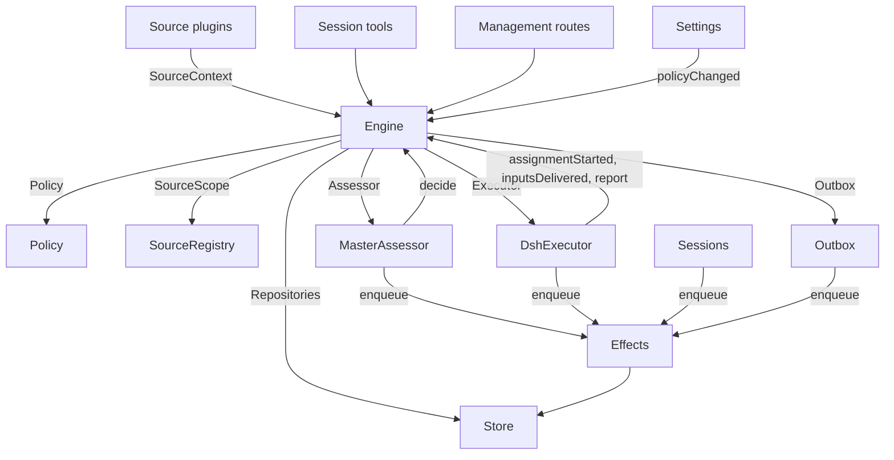

# 007 架构

这是实现层面的开发者指南。它把 [001 领域模型](001-domain.md) 到 [006 部署](006-deployment.md) 中的概念映射到类、接口与文件。先了解运行时与 Engine，再用模块表和测试表作为代码索引。

## 核心类与胶水层

核心类在小接口之后拥有领域概念与外部边界。胶水层把工具参数、HTTP 请求、Source 载荷和 DeepSeek Harness 事件翻译成对这些类的调用，再把结果变成卡片、视图与消息。

`Runtime`（`src/app/runtime.ts`）构造应用、供给依赖，并拥有启动与关闭。`Engine` 自行构造其内部各部分。执行者与判定者会回调 Engine，因此 Runtime 给它们提供 getter，而不要求按循环顺序构造。

### Runtime

`Runtime` 是组合根；其中不含任何领域规则。它的构造函数锁定状态目录、打开 Store 并构造各个组件。若构造失败，它会关闭 Store 并释放锁。

启动过程注册管理路由并运行 Setup。Setup 完成后，它安装 Session 与 Executor 的钩子，确保主 Session 存在，启动 Policy 同步，恢复被中断的 Assignment，并启动 passes 与 effects。`ready` 标记启动的完成。

关闭过程取消 turns、等待 passes、effects 与 agents、恢复进程环境、关闭 Store 并释放锁。Source 插件通过窄接口 `SourceHost` 把 Runtime 注入为 `orchestrator` 服务。

| 部件 | 模块 | 作用 |
| --- | --- | --- |
| Setup | `src/app/setup.ts` | 以 worker shell 运行 CLI 的方式探测仓库与账号，从而解析它们，写入并应用 worker 的环境与命令 shim，并保存 setup 的问题；Settings 通过它检查变化的账号，也通过它重启，重启会再次运行 setup |
| Passes | `src/app/passes.ts` | 每次一个 pass，每两秒一次，也在有命令请求时进行：先处理到期 effects，再调用 `Engine.evaluateDue`；Source 的 Trigger 经由它抵达 Engine |
| Outbox | `src/app/outbox.ts` | Engine 的 `Outbox` 端口，也是收据的唯一写入方：`send` 在一个事务中保存消息的收据并排入其 `reply` effect，而该 effect 的处理函数通过 `SourceRegistry.send` 发送；消息在其 Source 关闭时等待，会话消失或无人监听时被丢弃 |
| Notices | `src/app/notices.ts` | 把领域事件与 worker 活动转成主 Session 的消息。`eventNotice` 处理领域通知；`reportRelay` 立即转发问题，把普通进展留在其 Ticket 上，并转发其他报告；`followupRelay` 指明拥有某个人工跟进的 Tickets。在 turn 期间到达的转发会在其下一步通过 DeepSeek Harness 收件箱一起投递 |

### Engine

`Engine`（`src/core/engine.ts`）是 Triggers、Threads、Decisions、Tickets 与 Assignments 的唯一写入方。它从 `src/core/ports.ts` 接收这些端口：`Repositories`、一个当前 Policy 的 getter、`SourceScope`、`Assessor`、`Executor` 与 `Outbox`。可选依赖为 `prepareTicket`、`now` 与 `emit`。

Engine 的所有方法都是同步的。每个命令在一个事务内修改其聚合。`evaluateDue` 对它所修改的每个 Eval 或 Ticket 使用单独的事务。端口在事务内排入外部工作；适配器在提交之后执行这些工作。无效请求会抛出 `UserError`。

Engine 暴露一个入口，并委派给五个内部部分。它拥有每个命令的事务。跨越多个部分的命令，例如 `attach`、`evaluateDue` 与 `policyChanged`，按顺序调用这些部分。

每个部分都继承 `EnginePart`（`src/core/part.ts`），后者提供选项与共享读取。部分之间的依赖是单向流动的：

| 部分 | 职责 | 依赖 |
| --- | --- | --- |
| `Intake` | 一个 Source 的 Trigger：连同其处置状态存储一次，记录到其 Threads 及其关联关系上，向订阅的 Tickets 扇出，并且除非它是到达某个 Ticket 的人的消息，否则排入其主 Thread 的 Eval | Tickets |
| `Evals` | Threads 的 Evals：批处理、门槛的强度、执行者与依据（连同给出它们的 Trigger，即 `primary`）、来自候选投递的截止时间及其被暂停后的顺延、过期 Eval 的重新排队、候选、重放与交回、Policy 变更时的重新排队，以及每个 Eval 最终的 Decision：接受、停止、忽略或不可用 | Tickets |
| `Tickets` | Ticket 生命周期：由接受创建并带上其 Mandate、Subscriptions 与首个 Assignment，它关注的 Threads 及其关闭（`followsDone`）、所附着的 Threads 以及为获取上下文而关注的 Threads、Inputs 与备注、恢复以及恢复拒绝的消息、重试、重启、停止与结束、它丢弃的 Subscriptions，以及向它涉及的 Tickets 发出的 Policy 变更通知 | Replies |
| `Assignments` | Executor 与其 workers 报告的事实：Assignment 已开始、Inputs 已抵达或未能抵达、重启中断了它，以及 worker 的 Report 及其向人提出的问题 | Tickets、Replies |
| `Replies` | 通过 `Outbox` 的频道写入：确认、答复、结果与关注消息，各自依据允许它的规则 | 无 |

命令使用祈使式名称，例如 `stopTicket`；适配器报告的事实使用过去式名称，例如 `assignmentStarted`。查询 `candidate` 使用名词。

调用方只得到 Engine 中与其角色对应的 `Pick`：`EngineForSources`、`EngineForMainSession`、`EngineForPeople`、`EngineForSettings` 或 `EngineForExecutor`。
| 角色 | 方法 | 效果 |
| --- | --- | --- |
| Sources | `receive(trigger)` | 存储 Trigger 一次，并回答 `stored`、`duplicate`，或在没有任何 Source 接收它时回答 `filtered`；把它扇出到订阅其 Threads 的 Tickets，其中人的消息会立刻恢复一个已结束的 Ticket，除非处理被暂停；并把它排入其主 Thread 的 Eval，除非它是到达某个 Ticket 的人的消息，那就仍属于该 Ticket |
| Sources | `bindThread(ticketId, thread, own)` | 让一个开放的 Ticket 关注该 Source 的某个 Thread，例如一个拉取请求的 Thread，当 Ticket 开启它时 `own` 为真；一个已关闭的 Thread 再次绑定时会重新打开。由 Threads 的关闭而非 `ready` Report 结束该 Ticket |
| Sources | `threadClosed(thread, outcome, at)` | 一个 Thread 已关闭：关注它的每个开放 Ticket 都记录这次关闭，并在它完成了对自己所关注 Threads 的处理（`followsDone`）后结束：它开启的 Thread 都不再开放，或者当它没有开启任何 Thread 时，它关注的每个 Thread 都已关闭。它以这些关闭中最新的一次为准，以 `merged` 或 `closed` 结束，除非关闭之后恢复的工作尚未报告 `ready`，或者它的 Executor 接手了它，即在它最新 Report 之后（`progress` 除外）由它决定向人提出的某个跟进，或其最后一个 turn 结束；此时一份 `dropped` Report 会像那次关闭一样结束它 |
| Main Session | `candidate(triggerId)` | 持有该 Trigger 的 Eval，按判定者所见的样子 |
| Main Session | `candidateDelivered(evalId)` | 该 Eval 的候选已抵达主 Session：其截止时间从此刻起算 |
| Main Session | `decide(triggerId, outcome)` | 记录一个 Eval Decision，或为显式请求记录一个直接 Decision。接受会原子地创建 Ticket、Mandate、Assignment、Subscriptions 与确认。从卡片上忽略一个推断出的候选时，会先记录 `ignoredFromCard` 再给出所提供的理由。当 `followupOwners` 仍拥有某个人工跟进时，只允许停止 |
| Main Session | `attach(ticketId, triggerId, note?)` | 把一个 Trigger 路由到它所指向的 Ticket，该 Ticket 的 Executor 随后把它作为跟进来决定，并结束持有它的 Eval，其他 Triggers 则等待一次新的 Eval；一个已结束的 Ticket 会立刻在其 Mandate 下恢复，除非处理被暂停。一个 Executor 仍在决定的跟进会被拒绝，被路由回交回它的那张 Ticket 的跟进同样被拒绝 |
| Main Session | `requestStatus(ticketId)` | 向一个正在等待的 Executor Session 询问其状态，并回答是否已发出询问 |
| Main Session | `note(ticketId, text)` | 把来自其他工作的事实作为文本 Input 交给某张 Ticket 的 Executor，它不授予任何权限 |
| Main Session, Executor | `reply(request)` | 为其用途所指明的频道排入一条消息：`acknowledgement`、`answer`、`result` 或 `attention` |
| People | `stopTicket(ticketId, reason?)` | 人的停止，它撤回 Mandate |
| People | `retryTicket(ticketId)` | 结束一张在 `failed` 或 `blocked` Report 之后等待人的 Ticket 的停滞 Assignment，或结束一张 Input 投递失败（`canRetry`）的 Ticket 的停滞 Assignment，并启动一个新的 Assignment |
| People | `reevaluate(triggerId)` | 把一个已存储的 Trigger 排入一次新的 Eval |
| People | `unsubscribe(thread)` | 丢弃某个 Thread 上的所有 Subscription，关注的 Tickets 也不再关注它；每个 Ticket 仍决定它在那里收到的跟进 |
| People | `dismiss(decisionId)` | 忽略一个 `unavailable` Decision 所展示的问题，该 Decision 会记录这一事实 |
| Executor | `assignmentStarted(ticketId, assignmentId)` | 一个 Assignment 在运行；它等待中的 Inputs 被发出 |
| Executor | `inputsDelivered(ticketId, assignmentId, inputIds)` | Inputs 已抵达该 Assignment 的 Executor Session，其中每个都在等待某个 step 接手它 |
| Executor | `inputsRead(ticketId, inputIds)` | Executor Session 已把承载这些 Inputs 的消息纳入其历史（一个 `user/message` Session 事件），其模型由此获得它们；一个已认领它们但在之前被取消或失败的 step 不算。每个 Input 在其后出现 Report 或 turn 结束时算作已读，重启之后也一样，而其 Ticket 的结束并不放弃它；在已记录读取之前投递的 Input，在其后出现 Report 或 turn 结束时算作已读 |
| Executor | `turnEnded(ticketId, assignmentId)` | Executor Session 的一个 turn 结束了，也包括 Report 之后，在其后台没有运行任何东西或它正交给一个人时结束。它在结束前拿走的 step 所取得的输入，算作已读（`inputsRead`） |
| Executor | `deliveryFailed(ticketId, assignmentId, error)` | 投递 Inputs 失败；Ticket 会显示它，直到某次投递成功、新的 Assignment 开始或 Ticket 结束 |
| Executor | `report(ticketId, report)` | 记录一份 Report 及其向人提出的问题；`dropped` 结束该 Ticket，`ready` 完成一张不关注任何 Thread 的 Ticket，并以 Threads 各自结束的方式结束一张已完成关注处理的 Ticket |
| Executor | `markUnrelated(ticketId, thread, reason)` | 只丢弃该 Ticket 对某个它发现不相关的已附着 Thread 的 Subscription，并连同理由交回该 Ticket 在那里决定的那些跟进 |
| Executor | `followForContext(ticketId, thread)` | 把一张开放的 Ticket 订阅到某个相关 Thread 以获取上下文：其消息会抵达该 Ticket，但不给它任何跟进力度，也不会恢复它 |
| Executor | `handback(ticketId, triggerId, reason)` | 记录该 Ticket 交回一个到达它的 Trigger，连同其候选所携带的理由，并在没有其他 Ticket 决定它时排入一次新的 Eval，若本 Ticket 曾决定它的话；它回答是否已排入。一张 Ticket 对每个 Trigger 只交回一次，并保留其 Subscription |
| Executor | `assignmentInterrupted(ticketId, assignmentId)` | 一个 Assignment 在主机停止时正在运行：中途被中断的，或在最新 Report 之后收到过 Input 的，会带一条恢复说明以及投递给它但其 Executor Session 未接手的 Inputs 重新开始，就像重试一样；此后已报告过的则保留其 Session。DshExecutor 在启动时报告每一个（`resume`），最老的 Ticket 优先，并把等待中的启动重新排入 |
| Passes | `evaluateDue()` | 除非处理被暂停：启动那些排队 Trigger 仍在等待的 Threads 的 Evals，每个 Thread 一个，期间排队的 Triggers 合并为一批；把超过截止时间的 Eval 的 Triggers 再次排队，连续两次之后第三次则记录为 `unavailable`；并恢复人在暂停期间触及的已结束 Tickets，只要它们的 Mandate 仍然成立。候选尚未抵达主 Session 的 Eval 不会过期。处理暂停期间没有 Eval 过期，一旦恢复，每个截止时间都按暂停时长向后顺延 |
| Settings | `policyChanged(from, to, effects)` | 告诉每个活跃 Ticket 该变更如何影响它（`src/policy.ts` 中的 `policyEffects`：它被接受时所依据的规则变了或不再适用，它的请求者可能不能再启动工作，或主动工作不再被接受），并在新的版本下重启进行中的 Evals |

Engine 把批处理、授权、扇出、恢复与关注生命周期规则保持为私有。若干共享谓词让这些规则保持一致：

- `waitsForPerson`（`src/core/model.ts`）：最新的 Assignment 报告了 `blocked` 或 `failed`，且此后没有收到人的消息。只要这一点成立，自动 Inputs 与失败的启动都会被扣留。
- `followupOwners`：仍对在自身 Threads 上收到的人工跟进负责的 Tickets。一张 Ticket 可以是活跃的，也可以是在没有人停止它的情况下已结束并等待恢复。交回该消息即终止这份责任。
- `settled`：一个 Decision 解决了该请求；停止、不可用、已路由与被拒绝的停止 Decision 都不计入。
- `ticketStage`（`src/core/stage.ts`）：实现 [003 执行](003-execution.md) 中的阶段表。

当一张 Ticket 结束时，未读的跟进会重新回到 Eval，除非另一个 Ticket 仍拥有它们或另一种处置已把它们了结。已确认、已答复与已交回的消息被排除。对于缺少确认处置的较旧记录，outbox 的收据提供这一事实。最终的 Report 还涵盖 Assignment 开始时正在等待的消息，包括恢复它的那条消息。停止某张 Ticket 的消息不会被自动重新评估。

变更之后，Engine 会从 `src/core/ports.ts` 的 `DomainEvents` 发出一个事件：

`trigger.received`、`eval.started`、`decision.recorded`、`ticket.created`、`ticket.resumed`、`ticket.ended`、`assignment.started`、`assignment.ended`、`thread.subscribed`、`thread.unsubscribed`、`trigger.requeued` 或 `policy.changed`。

Runtime 把 `ticket.ended`、`trigger.requeued` 与 `thread.unsubscribed` 转成通知。投递给 Tickets 的人的 `trigger.received` 会成为一次跟进转发。`pullEndNotices` 在一张 Ticket 以 merged 或 closed 结束时，使用一个稳定的 id 发送一条聊天通知。其他事件目前没有消费者。

### Model

`src/core/model.ts` 保存领域类型，`src/core/stage.ts` 保存 Ticket 阶段。一个 Decision 以 `reason` 记录原因，一个 `Reason` 列表（`src/core/reasons.ts`）：每一个是一个 `code` 及其 `values`，对于批次中的一个 Trigger 还有其 `triggerId`。

核心的 codes，例如 `timeout`、`policyChanged`、`routed` 与 `startedTicket`，是 `REASONS`，带有智能体通过 `reasonText` 读取的英文文本；门槛或 Source scope 给出自己的 code，例如 `not_a_member`；而 `said` 承载判定者或人写下的话。面板按 `reason.<code>` 为每个 code 标注文字，Source 过滤掉的 Trigger 也以同样方式记录该 Source 的 code。

一张 Ticket 每个事实只保存一次。它在没有 `ended` 时是开放的，该字段记录它何时结束、由谁结束、为何结束以及以什么结果结束；它最后说的是它最新的 Assignment Report（`latestReport`）；它的 Executor Session 以它命名（`src/executor/dsh.ts` 中的 `workerSessionId`）。

它的字段是有类型的：`origin`，那个可准入的 Trigger 及其 Eval 批次的强度来源以及该批次本身（`triggerId`、`triggerIds`）；`execution`，Executor 的选择（`name`、`directory` 与 `assignment`）；`delivery`，最后一次失败的 Input 投递（`error`、`at`），直到某次投递成功、新的 Assignment 开始或 Ticket 结束；以及 `follows`，Source 让它关注的那些 Threads，每项为 `{thread, own, closed?}`：当 Ticket 开启它时为 `own`，关闭后为 `closed` 并带上 `at` 与 `outcome`。只有 Tickets 写入 `follows`；GitHub Source 用 `pullsOf` 与 `pullOf` 读取其拉取请求（`src/sources/github-pull.ts`）。

承载 Trigger 的 Input 会记录它是否由人写下，`waitsForPerson` 会读取这一点。Thread 还会在 `context` 中列出仅为其上下文而关注它的订阅 Tickets，并在 `expired` 中计入其排队 Triggers 的 Evals 连续过期的次数；一个 Eval 记录其 `primary` Trigger 以及其候选何时被 `delivered`。

一个 Trigger 的处置状态会记录它抵达的 Tickets，无论是通过扇出还是附着、人的重新排队、每个交回它的 Ticket 及其理由，以及每个其 Executor 确认或答复了它的 Ticket。

一个 Mandate 的 `basis`（`MandateBasis`）记录门槛是如何准入其 Trigger 的。重新校验会读取接收方的 `source`、`scope` 与 `row`、列出的 `sender`、匹配的 `rules`，以及 `via`：

| `via` | 准入依据 |
| --- | --- |
| `addressed` | 一个被允许的发送者对智能体发起了寻址 |
| `followup` | 一条消息抵达了一个带有 Tickets 的 Thread |
| `admission` | 准入表中的一个单元格；`observation` 标记一个推断出的候选 |
| `bot` | 一个列出的 bot 产生了一个推断出的候选 |

Trigger 与 Thread 的 `meta` 归 Source 所有。核心不对它们作解释。

### Policy

`src/policy.ts` 定义设置模式、授权与评估规则。`settingsPolicy(settings, scope)` 每次使用都返回一个全新的、无状态的 `Policy`：

- `version`、`paused` 与 `evalTimeoutMs` 描述其当前状态。
- `gate(trigger, thread, tickets)` 返回准入强度与依据。
- `revalidate(mandate)` 检查一个既有 Mandate 是否仍然成立。
- `admitsInferred(rules)` 只在自动模式且匹配的规则已启用时才允许主动接受。

`assessmentOutcome(assessment, settings, strength)` 把模型的评估转换为 Engine 的结果。它要求每条启用的规则都有判定、方向已确定、有一条匹配的规则以及意图的证据。在自动模式之外，一个推断出的接受会变成一条“将会接受”的记录。

`policyEffects(tickets, old, now, scope)` 指出一次变更影响哪些开放的 Tickets 以及如何影响。`Engine.policyChanged` 只通知这些 Tickets。`policyVersion` 对规则、接受模式与各 Source 的 Policy 部分（包括 bot 列表）做哈希。

### Store

`Store`（`src/app/store.ts`）拥有一个 SQLite 数据库。Runtime 在打开它之前获取目录锁，防止第二个进程迁移或写入同一份状态。

它的接口按用途分组：

- **领域仓储：** `atomic`，以及 `triggers`、`threads`、`tickets` 与 `decisions`，各有 `get`、`save` 与列表查询。带索引的工作集合有 `threads.active()`、`tickets.open()`、`tickets.active()` 与 `read.subscribedThreads`。
- **读取查询：** `read` 通过 `threadTriggers`、`triggerStats`、`search` 与 `droppedReplies` 等方法为视图、工具与 Source 轮询服务。这些方法从不写入。
- **Source 元数据：** `threads.describe` 与 `threads.patchMeta` 更新 Source 自有的 Thread 元数据。
- **设置：** `settings`、`saveSettings`、`blockRevision` 与 `settingsHistory`。设置与提示词使用带编号的 `Versions`（`src/app/versions.ts`）。
- **Outbox 收据：** `replyStatus` 与 `receipts`，只由 Outbox 写入。收据操作有 `get`、`waiting`、`behind`、`add`、`settle` 与 `withdraw`。`behind` 检查同一 Ticket 与同一会话的更早消息是否正在等待且失败次数少于三次。已撤回的消息以 `channelGone` 或 `channelIgnored` 了结。读取查询通过 `failingReplies`、`droppedReplies` 与 `droppedSince` 暴露失败与被丢弃的回复。
- **带类型的键值记录：** `get`、`set`、`delete` 与 `keys`，使用来自 `KV` 的条目。

`afterCommit` 只在事务提交之后运行动作，绝不在回滚之后运行。Runtime 以其存储形态读取记录；schema 11 的迁移在启动时把较旧的受支持记录转换为当前形态。

### Effects

`Effects`（`src/app/effects.ts`）是持久的副作用队列。一个命令在其事务内调用 `enqueue(kind, key, payload)`；执行只在提交之后才开始。

每个 kind 与 key 的组合只有一行。重复排入同一个等待中的 key 会替换其载荷并让它立即到期，但不改变队列顺序。`handle(kind, run, options)` 为每个 kind 注册一个处理函数。它按最旧优先处理到期行，直到并发上限。

失败以指数退避重试。抛出 `Later` 会推迟工作且不计入失败，例如没有可用 worker 槽位时。`start` 在 setup 之后开始处理，`drain` 在关闭期间停止它并保留待处理的行，`pending` 与 `idle` 暴露队列状态。

| Kind | 处理方 | 作用 | 并发 | 重试 |
| --- | --- | --- | --- | --- |
| `assessment` | MasterAssessor | 把一个 Eval 的候选卡片导入主 Session 的 turn，然后告诉 Engine 它已投递，从而启动该 Eval 的截止时间 | 4，暂停时为 0 | 2 秒，翻倍到 60 秒 |
| `launch` | DshExecutor | 启动一个待处理的 Assignment：准备命令、Executor Session、assignment 消息 | 空闲的 worker 槽位，暂停时为 0 | 模型提供方或网络的一次可恢复失败在 5 秒后重跑，翻倍到 300 秒，共三次；其他任何失败以及失败的准备命令，会让其 Ticket 失败。被暂停或 worker 槽位已满而扣留的，在 5 秒后再试 |
| `delivery` | DshExecutor | 按顺序把一张 Ticket 等待中的 Inputs 交给其正在运行的 Assignment | 4，暂停时为 0 | 2 秒，翻倍到 60 秒；等待 worker 槽位的在 2 秒后再试 |
| `relay` | Sessions | 把 worker 的报告或问题、或人的跟进导入主 Session 的 turn | 1，按队列顺序 | 2 秒，翻倍到 60 秒 |
| `notice` | Sessions | 把一条通知注入主 Session 而不唤醒它 | 1，按队列顺序 | 2 秒，翻倍到 60 秒 |
| `reply` | Outbox | 通过其 Source 为一个频道发送消息，在该 Ticket 发往同一会话且尚未失败三次的更早消息之后；撤回该消息会取消它 | 1，暂停时为 0 | 5 秒，翻倍到 300 秒；其 Source 关闭或被更早消息挡住的，在 5 秒后再试 |

每个 kind 在其名下都有一条健康条目。它在其中某个 effect 连续失败三次后报告一次错误，但 `delivery` 除外，它的失败显示在各自的 Ticket 上。转发保持顺序，通知同样如此；某个失败项会挡住同 kind 的后续项。

### Sources

Sources 通过 `src/sources/kind.ts` 中定义的 `SourceKind` 扩展宿主。一个 kind 声明其身份、标题、描述、配置 `schema` 与 `fields`、派生的 `facts`，以及 `health` 条目。可选行为包括 `scope`、一个 `channel`（`allowed`、`send`、`link`）、`threadContext`、`find`、`policy`、`environment` 与 `refreshLabels`。

`SourceRegistry`（`registry.ts`）拥有已注册的 kinds 与已存储的实例，并实现 Engine 的 `SourceScope`。注册会在 `HealthBoard` 上认领健康条目；重复认领与保留的 `sync:` 名称会被拒绝。SourceContext 只通过其注册所认领的条目写入，因此注销之后的报告不会有任何效果。

Registry 的配置方法包括 `kind`、`instances`、`instance`、`validate`、`validatePolicy`、`policyPart`、`channelAllowed`、`declarations`、`environments`、`find` 与 `scope`。`find` 向每个支持搜索的 kind 询问。

通用代码通过 registry 访问 Source 行为。`send(message, commands)` 调用该 kind 的 Channel 并返回 `sent`、`gone`，或在 kind 未安装时返回 `waiting`。`link` 解析其 Channel 链接。`threadContext` 把一个 kind 的读取器与其配置配对，或在该 kind 没有读取器时返回空。无效的已存储配置会禁用该实例。

插件接收 `SourceHost`：registry 与 `context(kind)`。kind 本身使用更窄的 `SourceContext`，由 `src/app/source-context.ts` 中的 `sourceContextOf` 构造。

该上下文提供部署与命令、setup 就绪状态（`ready`、`configured`、`problem`）、配置、`receive`、`atomic` 以及带类型的 `state`。它还暴露 Thread 读取与元数据写入、Ticket 读取与绑定及关闭命令、Trigger 读取、通过 Outbox 的 `notify`，以及用于已声明健康条目的 `report`。

### DshExecutor

`DshExecutor`（`src/executor/dsh.ts`）为每张 Ticket 提供一个 Session 与一个目录。`start` 与 `deliver` 排入 `launch` 与 `delivery` effects。`stop` 通过 `Store.afterCommit` 取消 turn，因此被回滚的结束不会停止 worker。

`prepare(ticket, outcome)` 提供 Engine 的 `prepareTicket` 钩子：短名称、目录与 `ticketExecution` 的 assignment 文本。`workerSessionId(ticket.id)` 派生 Session id。

`WorkerSlots` 在启动一次 launch 或一次会唤醒空闲 worker 的 delivery 之前预留容量。一条人的消息可以使用超出 `maxWorkers` 的一个槽位，唤醒优先于启动。`activeCount` 提供面板负载。

临时的提供方与网络失败有三次重试。启动使用 effect 退避；失败的 turn 在 15、30 与 60 秒后收到继续消息。`inputMessage` 依据当前 Ticket 状态渲染每个 Input，`mandateInstructions` 为推断出的工作添加匹配规则的限制。

`install` 订阅 Session 事件；`dispose` 取消订阅。turn 结束通常报告等待中，但在就绪之后或需要人工动作时除外。错误报告失败。在启动时，`resume` 通过 `assignmentInterrupted` 报告被中断的 Assignments，并把不等待人的待处理启动重新排入，最老的 Ticket 优先。

### MasterAssessor

`MasterAssessor`（`src/app/assessment.ts`）让主 Session 评估主动产生的候选。`request` 排入一个评估 effect；`release` 在其 Eval 结束时丢弃缓存状态。

它的 `context`、`read` 与 `decide` 方法服务于 `orchestrator_eval`、`orchestrator_eval_read` 与 `orchestrator_eval_decide`。它们通过 `SourceRegistry.threadContext` 提供有界的 Thread 上下文、仓储上下文，以及决策提交。没有上下文读取器的 kind 只提供 Trigger 与批次。

`assessmentOutcome` 把模型对 `Engine.decide` 的回答转换过来。Evals 会再次对照当前 Policy 检查推断出的接受。

### Settings

`Settings`（`src/app/settings.ts`）读取与写入带修订号的设置块。`current` 与 `view` 读取它们；`save(block, value, revision, origin)` 校验一次保存；`pause(paused, origin)` 改变独立的 `paused` 设置。

每次保存都声明其来源：`panel`、`tool` 或 `sync`。只有 `panel` 能改变执行环境或 `SETUP_FIELDS`（`src/deployment.ts`）中列出的字段。

Policy 版本的一次变更会计算 `policyEffects`、记录哪些 Tickets 被通知，并调用 `Engine.policyChanged`。`syncable` 与 `sync(id)` 刷新一个 Source 的 Policy 部分。`refreshLabels(id)` 刷新显示名称。

### Prompts

`Prompts`（`src/app/prompts.ts`）把配置存为 `Versions`。`current`、`version` 与 `history` 读取它们；`validate`、`preview` 与 `save(value, baseRevision, source)` 检查并保存它们。`compose` 与 `skills` 构建 Session 文本。

`builtInParts` 列出可覆盖的键、角色、默认文本与必需的模板占位符。每个覆盖项保存团队的 `text` 与一个 `base`：其原始默认值的 `builtInBase` 键。保存时把该默认值保存在 `KV.prompts.builtIn` 下。于是 `defaultChanged` 报告变化的默认值、可得时的旧文本，以及被移除的部分。

校验会从已保存的覆盖项继承被省略的 base，丢弃已存在于保存数据中的已移除部分，并拒绝空文本或其他未知键。这使保存工具能往返它读到的配置。`environmentSection` 与 `policySection` 只用自己的键替换模板值一次。没有覆盖项的配置使用默认值。

### Sessions

`Sessions`（`src/app/sessions.ts`）为两种角色管理 DeepSeek Harness Sessions。`ensure` 用其角色的模型创建一个 Session。`install` 跟随 agent 事件，并为受管的 Sessions 注册提示词、skills 与工具。

`prompt` 每个 request id 只投递一次。`relay` 与 `notify` 排入主 Session 的消息，由 `relay` 与 `notice` effects 处理。`src/app/notices.ts` 定义它们的内容；`delivery` 检查消息是否已到达。

每次模型请求都把 Session 绑定到当前的提示词修订。它所用的修订被持久保存：`promptVersion` 标识当前生效的修订，`mayRead` 限制 worker 可以查看哪些版本。注册情况按 agent 分别记录在一张映射表中。

`status` 与 `promptVersion` 服务提示词页面。保存通过 `Prompts.save` 进行，并通知主 Session。`modelRetry` 暴露模型预算的重试状态。

### Glue

| 胶水层 | 翻译内容 |
| --- | --- |
| `src/app/runtime.ts` | 组合根：用各部分所用的接口构造它们，注册路由与 Source 宿主，并启动与停止 dsh-superagent |
| `src/app/notices.ts` | 领域事件与 worker 报告转成主 Session 的通知与转发 |
| `src/app/tools/main.ts`、`src/app/tools/executor.ts` | 主 Session 与 Executor Sessions 的工具参数转成核心类的调用，并把其结果转成卡片 |
| `src/app/http.ts`、`src/app/views/`、`src/app/api.ts` | HTTP 请求转成调用，Store 读取转成面板的视图；`api.ts` 为面板标注每条路由的类型 |
| `src/app/resources.ts`、`src/app/links.ts`、`src/app/cards.ts` | 资源名转成读取，source 消息转成链接，记录转成供模型使用的紧凑卡片 |
| `src/sources/github*.ts`、`src/sources/feishu*.ts`、`src/sources/poll.ts` | GitHub 与 Feishu 载荷转成 Triggers 与 Thread 事实，消息转成 CLI 调用 |
| `src/deployment.ts`、`src/setup.ts`、`src/infra/` | Setup 探测与问题、CLI 传输、agent 的进程环境 |

## 依赖规则

- **显式而狭窄的依赖。** 每个类接收一个指明它所用内容的接口，多数是其他类的 `Pick` 类型：核心类有 `ExecutorHost`、`AssessorHost`、`SessionsHost`、`SettingsHost`、`SetupHost`、`PassesHost` 与 `OutboxHost`，胶水层有 `HttpHost`、`MainToolsHost`、`ExecutorToolsHost`、`ResourceHost`、`LinkHost` 与 `SourceContextDeps`，而 Engine 是调用它的那个角色的 `Pick`。Runtime 只在这种接口之后传递自身。Source 插件注入 `orchestrator` 服务，其类型把它命名为 `SourceHost`：registry 与 `context(kind)`；其 kind 的代码只看到自己的 `SourceContext`。
- **谁可以 import 什么。** `src/core` 除了 Node 的哈希之外不 import 自身之外的任何东西，也不做 I/O。`src/sources` 不从 `src/app` import 任何东西。面板只从宿主侧 import 类型，以及 `src/admission.ts`、`src/limits.ts`、`src/setup.ts`、`src/navigation.ts`、`src/sources/host.ts`、`src/core/errors.ts`、`src/core/reasons.ts` 的纯值与 `src/app/api.ts` 的过滤列表。
- **每种状态只有一个写入方。** 每种状态有一个写入方，其他人读取它或向该写入方询问。

  | 状态 | 写入方 |
  | --- | --- |
  | Triggers、Threads、Decisions、Tickets、Assignments | Engine |
  | 一个 Source 的读取位置，以及它在自己的 Threads 上保留的 meta（`label`、`url`、`facts` 及其自有键） | 该 Source，通过 `SourceContext` |
  | 设置及其历史 | Settings |
  | 提示词版本 | Prompts |
  | Effect 行 | Effects |
  | Outbox 收据 | Outbox：Engine 的消息与 Sources 的 `notify` 都经由它的 `send`，其 `reply` effects 为它们标记 |
  | 一个健康条目 | 在 `HealthBoard`（`src/infra/health.ts`）上认领它的那个部分，它拒绝第二次认领：`runtime` 是 Runtime，Passes 通过它上报，`evals` 是 Runtime 在每轮之后，`models` 是 Sessions，每种 effect kind 是 Effects，`worker` 是 DshExecutor，一个 Source kind 的条目是该 kind 的 Source 由 SourceRegistry 认领，`sync:<id>` 是 Settings |

  一个 Source 只能通过 `SourceContext.tickets.bindThread` 与 `threadClosed` 改变 Ticket，它们会调用 Engine。
- **请求与事实。** 索取某物的方法以祈使动词加宾语命名，例如 `stopTicket` 或 `bindThread`，并且可以被拒绝；记录适配器所做的事情的方法以过去式命名，例如 `assignmentStarted` 或 `deliveryFailed`。每个宿主接收它所需角色类型的 Engine。
- **带类型的字段，Source 数据归 Source。** 代码读取 Tickets 与 Mandates 的带类型字段。Source 不在 Ticket 上保留任何东西：一张 Ticket 关注其哪些 Threads 由该 Ticket 的 `follows` 记录，而它关于某个 Trigger 或 Thread 所保留的内容则在它们的 `meta` 中。
- **固定的拒绝。** 人或 agent 能造成的拒绝是 `src/core/errors.ts` 中 `USER_ERRORS` 提供的 `UserError(code, values)`。管理 API 对 `missing` code 返回 404，对其他返回 400，面板用自己的语言为每个 code 标注文字。Setup 问题是 `SetupError` codes（`src/setup.ts`）与固定的健康文本 `HealthCode`s（`src/sources/host.ts`），措辞方式相同。

### Source 特有的依赖

一些通用模块仍直接指向 GitHub 或 Feishu：

- Outbox 应用飞书聊天字数限制。
- `src/app/links.ts` 解析飞书消息链接与 `repliedTo`。它与 Runtime 用 `feishuSettings` 读取设置。
- `src/app/resources.ts` 读取 `feishu/` 与 `github/` 原文；`src/app/cards.ts` 用 `pullOf` 生成 Ticket 卡片。
- Runtime 为 merged 或 closed 的 Tickets 发送 `pullEndNotices`。
- Executor 工具用 `readPull` 与 `claimPull` 绑定所报告的拉取请求，使用 Runtime 暴露的 GitHub 上下文。
- MasterAssessor 用 `readRepositoryPath` 读取仓库文件。
- Sessions 与 Prompts 只为 GitHub 与 Feishu 注册内置 skills。迁移转换它们的 schema-10 记录。
- Setup 只探测 GitHub 与飞书账号字段（`SETUP_FIELDS`）。只有这些 Sources 通过 `SourceContext.problem` 收到账号 setup 问题。

## 模块

| 路径 | 职责 |
| --- | --- |
| `src/index.ts` | 主插件入口：读取机器设置、启动 Runtime，并把 Source 账号保存时使用的重启交给它 |
| `src/deployment.ts` | 插件 `Config` 与 `Machine`；`resolveDeployment` 与 `resolveFeishuBot` 从 Source 设置读取仓库与账号，每个 CLI 都按 Executor shell 运行它的方式运行；`SETUP_FIELDS` 列出 setup 读取的 Source 字段。代码不指明任何人、账号或组织 |
| `src/setup.ts` | Setup 问题：`SetupError`，带一个 code、修复它的地方，以及日志、主 Session 与面板共用的英文文本 |
| `src/policy.ts` | Policy：按块划分的设置模式、Policy 版本、门槛与 Mandate 重新校验 |
| `src/admission.ts` | 准入表的取值、每个单元格的选项与默认值，与面板共享 |
| `src/limits.ts` | 人所设置取值的限制，由设置模式校验，并由面板的字段提供 |
| `src/kv.ts` | `KV`：`kv` 记录的每个族及其键、值类型与所有者，以及 Store 与 `SourceContext.state` 接受的 `Key` 与 `Family` 类型 |
| `src/navigation.ts` | 在宿主目录列出某个 Session 后，从面板打开一个 DeepSeek Harness Session |
| `src/core/model.ts` | 领域类型，其中有带类型的 Ticket 与 `MandateBasis`，以及 `threadKey`、`ticketOutcome`、`reached`、`followupOwners`、`settled`、`waitsForPerson`、`liveTicket`、`runningAssignment`、`latestAssignment` 与 `latestReport` |
| `src/core/ports.ts` | 端口：`Repositories`、`Policy`、`SourceScope`、`Assessor`、`Executor`、`Outbox`，以及领域事件 |
| `src/core/engine.ts` | Engine，核心的入口点，以及角色接口 `EngineForSources`、`EngineForMainSession`、`EngineForPeople`、`EngineForSettings` 与 `EngineForExecutor` |
| `src/core/part.ts` | `EnginePart`，Engine 各部分的基类，以及 `EngineOptions` |
| `src/core/intake.ts` | `Intake`：来自 Sources 的 Triggers、到它们的 Tickets，以及（除非是人的消息抵达其中之一）到 Eval |
| `src/core/evals.ts` | `Evals`：Threads 的 Evals 及其 Decisions |
| `src/core/tickets.ts` | `Tickets`：Ticket 生命周期、一张 Ticket 关注的 Threads、Subscriptions 与 Inputs |
| `src/core/assignments.ts` | `Assignments`：Executor 的事实及其 workers 的 Reports |
| `src/core/replies.ts` | `Replies`：Engine 的频道写入 |
| `src/core/stage.ts` | `ticketStage` 与 `canRetry`：[003 执行](003-execution.md) 的 Ticket 阶段 |
| `src/core/errors.ts` | `UserError` 与 `USER_ERRORS` |
| `src/core/reasons.ts` | `Reason`、`REASONS` 与 `reasonText`：核心为何记录一个 Decision 或搁置一个 Trigger，按 code 区分 |
| `src/core/ids.ts` | `key`：由输入派生的 id，相同输入得到相同 id |
| `src/core/memory.ts` | `MemoryRepositories`：内存中的 Store 仓储，顺序与 Store 相同并带有其嵌套回滚，用于领域测试 |
| `src/core/index.ts` | 核心的导出 |
| `src/app/runtime.ts` | Runtime，组合根，及其启动与停止 |
| `src/app/setup.ts` | Setup，以及 `setupChanged`，判断一次保存是否改变了 setup 读取的字段 |
| `src/app/passes.ts` | Passes，pass 调度器 |
| `src/app/outbox.ts` | Outbox：Engine 的 `Outbox` 端口、收据，以及发送它们的 `reply` effects |
| `src/app/notices.ts` | 主 Session 的通知与转发：`eventNotice`、`reportRelay`、`resultRelay` 与 `followupRelay` |
| `src/app/store.ts` | Store，以及 `Receipt`，outbox 的一条消息 |
| `src/app/store-read.ts` | `storeReads`：Store 面向视图、工具与 Sources 轮询的读取查询，它们从不写入 |
| `src/app/migration.ts` | schema 11 迁移：从 schema 10 一步到位，把每条存储记录写成其当前形态 |
| `src/app/effects.ts` | Effects |
| `src/app/versions.ts` | `Versions`：一条记录以带编号的快照保存并带一个指向当前版本的指针，用于设置与提示词 |
| `src/app/cache.ts` | `TextCache`：在一定大小内保留于内存的文本，最久未用的先被丢弃 |
| `src/app/settings.ts` | Settings |
| `src/app/settings-history.ts` | `policyHistory`：每次保存的设置修订及其相对前一版本的变化 |
| `src/app/prompts.ts` | Prompts、`builtInParts`（团队可覆盖的内置部分）以及 `promptParts`（一个角色提示词各段的顺序） |
| `src/app/context.ts` | 内置提示词文本，从 `prompts/` 读取，以及 Sessions 读取的对话记录条目 |
| `src/app/skill-files.ts` | 打包文本：`promptFile`，把一个文件的逐行单句连成段落，以及打包的 skills |
| `src/app/sessions.ts` | Sessions |
| `src/app/delivery.ts` | `AgentDelivery`：每个 request id 向一个 DeepSeek Harness agent 投递一次消息，跨恢复的 Session 也一样 |
| `src/app/retry-health.ts` | `RetryHealth`：哪些 Sessions 在等待模型预算重试，用于 `models` 健康条目 |
| `src/app/role-models.ts` | 解析 Eval 与 Executor 的模型，并用其角色的模型初始化一个新 Session |
| `src/app/assessment.ts` | MasterAssessor、评估模式以及 `orchestrator_eval` 所回答的窗口 |
| `src/app/execution-environment.ts` | 执行环境：它的变量、一张 Ticket 的取值、目录根以及提示词段落的行，`src/app/prompts.ts` 把它们填入模板 |
| `src/app/source-context.ts` | `sourceContextOf`：每个 Source kind 的 `SourceContext` |
| `src/app/links.ts` | `sourceLink`，一个 Trigger 消息的页面，以及 `candidateCard` |
| `src/app/cards.ts` | 供模型使用的 Triggers、Tickets、Threads 与 Decisions 的紧凑卡片，Ticket 卡片状态的封闭集合 `TICKET_STATES`，以及 `textPage` |
| `src/app/resources.ts` | `RESOURCES` 与 `readResource`：`orchestrator_read` 为每个角色读取什么 |
| `src/app/tools/tool.ts` | `Tool` 类型、`readTool`、两种角色的 `orchestrator_read`，以及 `AcknowledgementSchema` |
| `src/app/tools/main.ts` | 主 Session 的工具 |
| `src/app/tools/executor.ts` | 一个 Executor Session 的工具 |
| `src/app/http.ts` | `/orchestrator/api` 路由：同源检查、请求限制，以及每种失败一种状态 |
| `src/app/api.ts` | `Api`，每条路由及其参数、查询、请求体与响应，以及各列表的过滤器；它只 import 类型，因此面板可以打包它 |
| `src/app/views/text.ts` | 视图文本的两种形态：`preview`，单行纯文本，以及 `markdown`，不含 HTML；`plain` 与 `readable` |
| `src/app/views/records.ts` | 各视图共用的行：Triggers、Tickets、Threads、Decisions 与频道链接，以及 `ownersOf`，一次性读取跟进的所有者 |
| `src/app/views/tickets.ts` | 按阶段划分的 Ticket 列表、一张 Ticket 的页面、Mandate 依据事实与 Executor 的负载 |
| `src/app/views/threads.ts` | Thread 列表、一个 Thread 的时间线、搜索与 Decision 列表 |
| `src/app/views/sources.ts` | Source 状态：每个 Source 实例的状态、它最近一天的计数，以及那天它过滤与丢弃了什么 |
| `src/app/views/settings.ts` | 设置页面的视图：每个块及其修订、每个 Source 的设置与其 kind 的表单，以及执行环境 |
| `src/app/views/overview.ts` | 概览：需要人的 Tickets、问题、最近一天的流转与 Executor 的负载 |
| `src/executor/dsh.ts` | DshExecutor、`WorkerSlots`、`ticketExecution`、`inputMessage` 与 `mandateInstructions` |
| `src/executor/background.ts` | worker 在 DeepSeek Harness 中的后台工作、其 Session 拥有的 shell 作业（`ctx.jobs`）及其 subagents（`ctx.subagents`）：`runningJobs`、`untilQuiet`、`killJobs`、`collectJobs`、`stopSubagents`、`stopBackground`、`until`，以及 `cancelled`，即其 subagents 被停止而取消 turn 的那些 workers |
| `src/infra/commands.ts` | `Commands`，CLI 传输：`run`；`api` 与 `pages`，限于配置的仓库并经过校验；`lark` 作为 bot；`git`。`CliError` 携带命令输出所报告的 code，例如 GitHub 的 HTTP 状态，而打印不出任何内容的命令以其结束方式失败，绝不以其参数失败；`validItems` 跳过并计数列表中格式错误的项 |
| `src/infra/environment.ts` | agent 的进程环境：命令 shim、git 配置与凭据助手、`runAsWorker`，以及对环境与 Ticket 目录的检查 |
| `src/infra/paths.ts` | 包的根目录，打包文件所在之处 |
| `src/infra/text.ts` | 字数统计与聊天消息上限、`fill` 与 `sameName` |
| `src/infra/health.ts` | `HealthBoard`、每个部分的健康条目，各自由其唯一的写入方认领 |
| `src/sources/kind.ts` | `SourceKind` 协议 |
| `src/sources/registry.ts` | `SourceRegistry` |
| `src/sources/host.ts` | `SourceHost`、`SourceContext`、`Health`、`health` 与固定健康文本 |
| `src/sources/poll.ts` | GitHub 与飞书轮询共有的部分：`POLL_HORIZON_MS`、`polled`、`cursorAt`，以及 `pollThreads`，它把失败作为 `pollError` 保留在其 Thread 上 |
| `src/sources/github.ts` | GitHub kind 与插件入口，导出为 `./github-watch`：一轮通知轮询、开放 Tickets 的拉取请求及其 CI，以及订阅的 Threads |
| `src/sources/github-trigger.ts` | GitHub 评论、评审、Issue 正文与 CI 变化作为 Triggers，以及 GitHub 寻址 |
| `src/sources/github-pull.ts` | 拉取请求规则：一张 Ticket 关注哪些拉取请求（`claimPull`、`observePull`）、它向 Engine 报告的关闭，以及 `pullEndNotices`，即以 merged 或 closed 结束的 Ticket 的聊天通知 |
| `src/sources/github-channel.ts` | GitHub Channel：评论与评审 thread 的回复，`sent` 或 `gone` |
| `src/sources/github-read.ts` | CI 快照、仓库读取、`github/` 资源，以及 `githubThreadContext`：一个 Issue 或拉取请求的对话，按页读取 |
| `src/sources/feishu.ts` | 飞书 kind 与插件入口，导出为 `./feishu-watch` |
| `src/sources/feishu-trigger.ts` | 飞书消息作为 Triggers，分别由实时事件、历史页与话题页的规则处理 |
| `src/sources/feishu-loops.ts` | 飞书循环：事件消费者、历史恢复、聊天名称与订阅话题的轮询 |
| `src/sources/feishu-channel.ts` | 飞书 Channel：话题回复，`sent` 或 `gone` |
| `src/sources/feishu-read.ts` | 一个 Trigger 消息的 `feishu/` 读取，其根、父与话题，以及 `feishuThreadContext`，它把它们连同图片交给评估 |
| `src/sources/admission-context.ts` | 评估开始时的有界窗口：一个 Trigger 的 Thread 的前几页，通过其 kind 读取，以及该 Trigger 周围的消息 |
| `src/sources/feishu-image.ts` | 把飞书消息的图片作为附件读取给评估 Session |
| `src/client/index.tsx` | 客户端插件入口：侧边栏入口、主面板，以及 DeepSeek Harness 插件管理器中的页面 |
| `src/client/app.tsx` | 面板：页头、搜索、术语表、标签页与当前路由的页面 |
| `src/client/provider.tsx` | 每个页面从其宿主读取的内容：复制、调用、导航、通知、状态轮询，以及 `restart`，它在 dsh-superagent 重启期间快速读取状态 |
| `src/client/api.ts` | 管理 API 的调用与轮询，类型由 `src/app/api.ts` 给出，以及 Eval 状态的 Decision 过滤器 |
| `src/client/route.ts` | 标签页、设置分组、`parseRoute` 读取的带类型路由，以及路由记忆，其中上次打开的设置分组会被记住 |
| `src/client/overview.tsx` | 概览 |
| `src/client/source.tsx`、`trigger.tsx`、`eval.tsx`、`execution.tsx` | 每个阶段一个文件：其状态，以及它有的那些设置 |
| `src/client/thread.tsx`、`ticket.tsx` | 记录页面：一个 Thread 及其时间线，以及一张 Ticket 的授权、Inputs 与 Assignments |
| `src/client/settings.tsx` | Settings 标签页：分组导航与屏幕上的分组 |
| `src/client/settings-kit.tsx` | 设置块的构建块：各阶段分组共享的设置、`useBlockDraft`、字段（其中一个 Source kind 的字段），以及保存历史 |
| `src/client/prompts.tsx` | Prompts 设置：页面拥有它读到的视图、编辑器拥有草稿，编辑、完整提示词与历史标签页由它们渲染；内置部分的编辑器显示变化的默认值，并保留或丢弃覆盖项 |
| `src/client/prompt-config.ts` | 按段、按团队分段的提示词配置、skill 名称、内置部分（`part/<key>`，配合 `withOverride`）与提示词视图给出的部分标题，以及完整提示词的行差异，均为纯函数 |
| `src/client/deployment.tsx` | Deployment 设置，也在 DeepSeek Harness 的插件管理器中显示 |
| `src/client/draft.tsx` | 设置草稿：`draftReducer`、其状态及其与更新的已保存修订的合并、`saveBarText`、保存栏的那一行，以及保存栏 |
| `src/client/controls.tsx` | DeepSeek Harness 控件的本地副本，遵循其标记、键盘行为与设计令牌，因为打包文件不 import `@deepseek-ai/dsh-client-ui-primitives`；它们不读取任何上下文 |
| `src/client/widgets.tsx` | 页面共用的小组件，读取面板的上下文：区块、页头、加载状态、时间、链接、需确认的操作、setup 检查与 Markdown |
| `src/client/rows.tsx` | 页面共用的行：一个 Ticket、一个 Thread 与一个 Decision、一个 Thread 的标签，以及自动消息连续段的折叠 |
| `src/client/markdown.ts` | 报告与问题的 Markdown 子集，以及消息中的裸地址，作为块与行内部分 |
| `src/client/text.ts` | 按 key 的复制文本，以及领域取值、理由、发送者与时间的措辞 |
| `src/client/marks.ts` | 视图所分类状态的标记：一张 Ticket 或一个 Thread 的阶段、一个 Source 的状态与一个 Decision 的结果，各表现为一个圆点、一个图标、一种色调与一个标签 |
| `src/client/locales.ts` | 两种语言的全部文案，以及 [001 领域模型](001-domain.md) 的术语表 |
| `src/client/client.css`、`css.d.ts` | 面板的样式表，以文本加载 |

`src/sources/github.ts` 与 `src/sources/feishu.ts` 也是两个 Source 插件的入口，由 `tsdown.config.ts` 构建，并在 `package.json` 中导出为 `./github-watch` 与 `./feishu-watch`。打包产物的 `cordis.patch.yml` 插入这三个插件，其中飞书处于禁用状态。

## 测试

| 测试 | 覆盖内容 |
| --- | --- |
| `tests/core-engine.spec.ts` | 内存仓储上的领域规则：接收、Eval、扇出、恢复与停止、被中断的 Assignments、暂停、Policy 变更、报告与结果、附着、回复、失败的投递与被忽略的问题 |
| `tests/stage.spec.ts` | Ticket 阶段，逐行验证 |
| `tests/policy.spec.ts` | Source scope、门槛、准入表、Mandate 重新校验、Policy 版本、设置迁移与评估结果 |
| `tests/registry.spec.ts` | `SourceRegistry`：实例、校验、Policy 部分、Channels 与 Thread 上下文 |
| `tests/sources.spec.ts` | 飞书与 GitHub Sources 在一个 `SourceContext` 上的行为：翻译、轮询与读取位置、拉取请求规则、健康状态 |
| `tests/commands.spec.ts` | 以部署账号进行的 CLI 调用、Channels 的答复，以及限定仓库范围的 GitHub 调用 |
| `tests/feishu-read.spec.ts`、`tests/github-read.spec.ts` | 飞书与 GitHub 的读取 |
| `tests/admission-context.spec.ts`、`tests/feishu-image.spec.ts` | 评估的 Thread 窗口，以及飞书图片读取 |
| `tests/assessment.spec.ts` | MasterAssessor 为每个 Eval 保留什么，以及何时放手 |
| `tests/background.spec.ts` | 等待 worker 的 shell 作业与 subagents：一次唤醒它的结束，以及一个停止的宿主 |
| `tests/bundle-patch.spec.ts` | 打包产物的 patch，按 DeepSeek Harness 读取它的方式，以及它定义的 Executor Sessions 的 agent 预设 |
| `tests/effects.spec.ts` | effect 队列：合并、上限、带退避的重试、健康状态与关闭 |
| `tests/passes.spec.ts` | Passes：一次一个，一轮 pass 期间被请求的那些在其之后作为一个运行，以及失败的 pass 所报告的运行时健康状态 |

| `tests/outbox.spec.ts` | 运行中的 Runtime 上的 Outbox：处理被暂停或其 Source 未安装时消息等待 |
| `tests/cache.spec.ts` | `TextCache` |
| `tests/queue.spec.ts` | Runtime 通过 effect 队列的工作，以及较早版本所存储的内容 |
| `tests/followups.spec.ts` | 人在一张 Ticket 的 Thread 上的跟进：它给主 Session 的通知、作用于它的工具、一阵跟进的开销；worker 的交回与上下文关注，以及主 Session 的备注 |
| `tests/health.spec.ts` | 每个部分一个健康条目，各自由其自身下一次成功清除 |
| `tests/delivery.spec.ts` | `AgentDelivery` |
| `tests/retry-health.spec.ts`、`tests/role-models.spec.ts` | 模型预算重试，以及两个角色的模型 |
| `tests/runtime.spec.ts` | 在模拟的 DeepSeek Harness 宿主上运行整个应用，通过工具与 HTTP |
| `tests/tools.spec.ts` | Sessions 的工具：每个角色的 `orchestrator_read` 读取什么，以及其他主 Session 工具的形态与校验 |
| `tests/runtime-concurrency.spec.ts` | 重叠的工作：pass 期间的 Triggers、投递与启动期间变化的 Tickets |
| `tests/http.spec.ts` | 同源与回环检查、每种失败的状态、请求体上限、路径参数与查询 |
| `tests/settings.spec.ts` | 与模型或账号检查竞争的设置保存、被一次保存抢先的 Policy 同步，以及暂停、同步与某个块的拒绝 |
| `tests/views.spec.ts` | 管理视图从 Store 推导出的内容，例如一条被丢弃的消息属于哪个 Thread |
| `tests/timeline.spec.ts` | 一个 Thread 的页面与一个 Trigger 的邻居，先按时间再按 id，且每个已接收 Trigger 的时间形式统一 |
| `tests/migration.spec.ts` | schema 11 迁移：每条存储记录都处于其当前形态，以及对更旧 schema 的拒绝 |
| `tests/store.spec.ts` | 仓储及其工作集合，在 SQLite 中与内存中相同，kv 区域，其中 `KV` 的每个键只在 `src/kv.ts` 与迁移中拼写，以及设置历史与查询 |
| `tests/prompts.spec.ts` | 提示词校验、组装与版本 |
| `tests/cards.spec.ts` | 内置文本必须陈述的规则，逐文件核对 |
| `tests/model-surface.spec.ts` | 模型读取的一切：工具、提示词、skills 与 Inputs，对照工具模式、执行环境与术语表核对，并在每个角色的规模预算内 |
| `tests/deployment.spec.ts`、`tests/environment.spec.ts`、`tests/index.spec.ts` | 插件配置与 setup、agent 的进程环境、插件入口 |
| `tests/service-script.spec.ts` | `scripts/dsh-superagent` 对着假的 `ps`、`tmux` 与 `dsh` 运行 |
| `tests/client.spec.tsx`、`tests/navigation.spec.ts`、`tests/controls.spec.tsx` | 客户端插件的注册与轮询、Session 导航与路由记忆、本地控件，以及面板的 import，它们没有循环 |
| `tests/panel-overview.spec.tsx`、`panel-source.spec.tsx`、`panel-trigger.spec.tsx`、`panel-eval.spec.tsx`、`panel-execution.spec.tsx` | 面板的每个页面，对照一个按路由应答的假管理 API |
| `tests/panel-settings.spec.tsx`、`panel-prompts.spec.tsx`、`panel-deployment.spec.tsx`、`panel-panel.spec.tsx` | 设置分组、草稿与历史、提示词、Deployment 页面，以及面板的搜索、术语表与路由记忆 |
| `tests/draft.spec.ts`、`tests/prompt-config.spec.ts`、`tests/markdown.spec.ts`、`tests/marks.spec.ts` | 草稿状态、合并与保存栏的那一行；按段的提示词配置与行差异；Markdown 子集及其链接；视图所分类的每个状态的标记 |
| `tests/locales.spec.ts`、`tests/styles.spec.ts` | 两种语言的文案、样式表 |
| `tests/class-docs.spec.ts` | `src` 中的每个类之前都有一个 JSDoc 块 |
| `tests/docs.spec.ts` | 带编号的文档只链接到更早的文档，每个本地链接都能解析，没有文档含合并冲突标记，且本文档的表格列出了每个模块与每个测试 |

`tests/fixtures/` 保存多个测试共享的内容：`host.ts`，一个模拟的 DeepSeek Harness 宿主；`panel-server.ts` 与 `panel.tsx`，假管理 API 与围绕某个页面的面板；`deployment.ts`，一个已解析的部署；`git.ts`，测试启动的每个 git 的环境，不指明任何仓库；以及 `async.ts`。

## 持久化

一个 SQLite 文件，`<stateDir>/orchestrator.sqlite`，只有 Store 会打开它。

| 表 | 保存内容 | 写入方 |
| --- | --- | --- |
| `trigger` | 每个 Trigger，其时间 `at` 采用 `Date#toISOString` 给出的唯一形式，在 Engine 接收它时设置，因此时间以文本比较 | Engine |
| `disposition` | 每个 Trigger 的去向：`filtered` 及其 Source 的 reason code、其 Eval 与 Decision、它抵达的 Tickets（通过扇出或附着）、它是否被重新排队、交回它的那些 Tickets 及其理由，以及其 Executor 确认或答复了它的那些 Tickets | Engine |
| `trigger_thread` | 每个 Trigger 位于哪些 Threads 上，连同它的时间以及是否由人写下，因此一个 Thread 的 Triggers 无需扫描每个 Trigger 即可按时间再按 id 读取：一个 Thread 时间线的一页从 `<at>|<id>` 游标继续，时间相同的 Triggers 不会被跳过 | Store，随每个 Trigger |
| `thread` | Threads：Subscriptions、仅为其上下文而关注它的 Tickets、排队 Triggers、进行中的 Eval、其过期计数与 `meta`；生成列 `active`，在 Triggers 排队或 Eval 运行时置位，以及 `subscribed`，在有 Ticket 订阅它时其 Source 置位 | Engine；Sources 写入 `meta` |
| `ticket` | Tickets 及其 Mandate、origin、execution、Assignments、Channels、Inputs 与它们关注的 Threads；生成列 `open`，在其未结束时置位，以及 `active`，在有 Inputs 未投递或最新 Assignment 待处理或运行中时置位 | Engine |
| `decision` | Decisions，按 Thread | Engine |
| `effect` | effect 队列：按 kind 与 key，载荷、其顺序、带最后错误的失败次数，以及何时到期 | Effects；schema 11 的迁移把较早版本为主 Session 保留的内容排队 |
| `outbox` | 每条发往某个频道的消息的收据，按 id，连同它所属的 Ticket 及其 `status`（`pending`、`sent` 或 `dropped`），保留下来以便一个 id 永不被排两次；对被丢弃的消息，以生成列 `dropped` 记录其时间与一个 reason code。等待中的消息有一个 `reply` effect，由它保存尝试次数 | Outbox |
| `kv` | 其他所有记录，按键 | 指名它的那个部分 |

生成列由其行的 JSON 计算得出，在其集合之外为空，并且每个生成列在其集合上都有索引，因此一轮只读取活跃的工作。早于某个列的数据库会在 Store 打开它时得到该列。

`KV`（`src/kv.ts`）定义每条键值记录的所有者、键与类型。所有读取方与写入方都使用这些条目；只有迁移代码会指名较旧的键。

| 记录 | 键或内容 |
| --- | --- |
| Schema | 当前 schema 版本 |
| 设置版本 | `settings-revision`、`settings-version:<n>`、`settings-block-revision:<block>`；快照包含来源、Policy 版本与受影响的 Tickets |
| 提示词版本 | `prompt-revision`、`prompt-version:<n>` |
| 主 Session | `master-id` |
| Session 提示词历史 | `session-prompts:<session id>` |
| Source 状态 | 诸如 `github-cursor:<number>` 的读取位置、PR 的 CI 指纹与已见的飞书话题消息；键以 kind 或 `thread-` 加 Thread key 开头 |
| 显示名称 | `source-labels:<source id>` |

忽略事实保存在其 Decision 上。Input 文本在读取时由 Ticket 渲染，因此二者都不需要单独的键值记录。

读取缓存使用有界的内存 `TextCache` 实例，并在重启后丢失。一个 Session 在分页浏览一条 Source 原文记录或提示词预览时，重启后必须从偏移 0 重新读取。入库后解析的飞书链接以同样方式缓存；基于链接的搜索只有在当前进程生命周期内读过该链接之后才能找到它。

目前还没有删除旧记录，因此这些会无界增长：`trigger`、`disposition` 与 `decision` 行；已结束的 Tickets 及其 Threads；outbox 的收据；以及在 `kv` 中，每个已保存的设置修订与提示词版本、每个 Session 工作过的提示词修订，以及各 Source 按 Thread 与按 Issue 或拉取请求保存的记录。

`SCHEMA_VERSION` 只会增加。版本更新的数据库拒绝启动；`src/app/migration.ts` 在启动时一次性把预发布 schema 10 的数据库升级，并拒绝更旧的版本。

## 面向模型的接口

### 主 Session 工具

主 Session 有 14 个应用工具：

| 用途 | 工具 |
| --- | --- |
| 读取与路由 | `orchestrator_read`、`orchestrator_route` |
| 管理 Tickets | `orchestrator_ticket_retry`、`orchestrator_ticket_request_status`、`orchestrator_ticket_note` |
| 重新评估 | `orchestrator_trigger_requeue` |
| 评估主动工作 | `orchestrator_eval`、`orchestrator_eval_read`、`orchestrator_eval_decide` |
| 通信与退订 | `orchestrator_reply`、`orchestrator_thread_unsubscribe` |
| 配置 | `orchestrator_settings_save`、`orchestrator_policy_sync`、`orchestrator_prompts_save` |

`orchestrator_route` 按顺序接受 1 到 20 条决定。每个接受、附着、停止或忽略都作为一条独立的 Engine 命令运行。它还允许直接从卡片上忽略一个推断出的候选。`orchestrator_ticket_note` 把事实作为上下文发送，而不是作为授权。

设置保存可选择 `policy`、`eval`、`executor`、`pause` 或 `source`；最后一种还要指明其 Source id。带 `preview: true` 的提示词保存只组装文本而不保存。

主 Session 还有 DeepSeek Harness 的 `skill`、`bash`、`read`、`read_image`、`job_output`、`job_list` 与 `job_kill`。避免读取代码是提示词规则，而非工具限制。

### 预设与等待上限

新的主 Session 使用 `dsh-superagent-router`（`ROUTER_PRESET`）。Shell 命令与作业等待在 5 秒后返回。如果 Web UI 在第一个 turn 之前选择了另一个预设，`Sessions` 会恢复该预设，对 worker 则恢复 `WORKER_PRESET`。

`src/app/sessions.ts` 中的 `noWait` 守卫会拒绝在命令位置调用 `sleep` 的主 Session shell 命令、超过 30 秒的 shell `timeoutMs`，以及超过 5 秒的 `job_output` 等待。报告与作业结果会自动到达，因此等待只会推迟进来的候选。

已存在的 `standard` 上的主 Session 同样需要为前台命令与作业等待显式设置超时；否则该预设的默认会让 step 分别保持 60 秒与 30 秒。宿主通过 `presetForSession` 确定当前预设，回退到 Session 投影或 header，若无法读取该值则假定为 `standard`。

### Executor 工具

每个 Executor 有六个应用工具：

| 工具 | 用途 |
| --- | --- |
| `orchestrator_read` | 读取其自身 Ticket 可用的资源 |
| `orchestrator_ack` | 确认一个请求 |
| `orchestrator_report` | 报告进展或结果，按拉取请求规则绑定一个拉取请求 |
| `orchestrator_thread_unrelated` | 丢弃一个不相关的已附着 Thread，交回它拥有的跟进，并告诉主 Session 原因 |
| `orchestrator_thread_follow` | 订阅一个相关 Thread 以获取上下文，并告知主 Session |
| `orchestrator_trigger_handback` | 交回一条消息一次，理由由其候选携带 |

若另一个 Ticket 仍拥有该消息，或本 Ticket 从未拥有它，交回会返回 `queued: false`。例如，一条 bot 消息被独立地送去了 Eval。

worker 预设在 `cordis.patch.yml` 中定义，并通过 `WORKER_PRESET` 选择。`src/app/sessions.ts` 中的 `WORK_TOOLS` 保留可用的文件、搜索、shell、作业、web、skill、todo 与 subagent 工具。workers 不会获得用于向人提问或呈现、更改 profile、在 worker 槽位之外调度工作、启动或向其他 Sessions 发消息、或编辑外部文档的工具。Ticket 结束之后工具调用会被拒绝。

### 结果形态与评估上下文

路由结果使用 `{decision?, reason, ticket?}`。`orchestrator_route` 返回 `{results}`，保持条目顺序并添加每项的 `trigger_id` 与 `kind`。无效或被拒绝的条目返回 `refused` 及一个理由，不会中断整批。

设置与提示词保存返回已保存的配置。Policy 同步返回该 Source、允许列表的大小，以及 `added` 与 `removed` 名称。

`orchestrator_eval` 返回上下文而不是指令。评估指令位于 `runtime/admission`（`prompts/admission.md`），规则位于 `runtime/policy`。它的上下文包括：

- Trigger 文本，最多 4,000 个字符，带图片 id 与批次中的其他 Triggers。
- 最多八个 `related_tickets`，开放的在前，以及 `tickets_total`。
- 该 Eval 的 `policy_version`。
- 一个 Thread 窗口：前五条消息以及 Trigger 两侧各五条消息。消息使用 `{id, from, at, text}`，通常限于 400 个字符，两侧各两条为 1,200 个字符。被截断的消息包含 `chars`；图片引用使用 `images`。
- 其他已加载消息的 `{id, from, preview}` 存根，各 50 个字符。`orchestrator_eval_read` 按 id 展开它们。

Ticket 卡片使用 `src/app/cards.ts` 中封闭的 `TICKET_STATES` 集合：一个开放阶段，例如 `person/review` 或 `working/queued`，或一个已结束的结果。无论通过接受、评估还是 `orchestrator_ack` 提交，确认都限于 100 个词。

### 读取资源

`src/app/resources.ts` 中的 `RESOURCES` 定义资源，并生成该工具的 `resource` 描述。

| 资源 | 内容 |
| --- | --- |
| `tickets`、`triggers`、`threads`、`decisions` | 分页列表，形式为 `{items, next_offset}`；活动列表把最新的放在前面 |
| `decision/<id>` | 一个 Decision |
| `thread/<key>` | 标签、Tickets、近期的 Decisions 与一页 Triggers |
| `trigger/<id>` | 消息文本、被回复的 Trigger 与相邻消息，不含 CI 运行 |
| `ticket/<id>` | 相关 id、源批次 Triggers、Threads，以及 Assignments 与 Inputs 的前几页 |
| Ticket 子资源 | `/assignments`、`/inputs`、`/assignment`、`/result`、`/report/<assignment id>`、`/transcript`、`/message/<n>`、`/input/<id>` |
| `settings`、`settings/<block>` | 修订与摘要，或一个准备保存的完整块 |
| `prompts`、`prompts/<revision>`、`prompts/current`、`prompts/defaults`、`prompt-preview/<id>` | 提示词配置与组装后的文本 |
| `models`、`models/<provider>` | 可用模型 |
| `feishu/<trigger id>/…`、`github/…` | Source 原文，在 Source skills 中有说明 |

Ticket 的 Threads 会标记为 `context`（仅用于上下文的关注）与 `bound`（Source 绑定）。Assignment 页面最新的在前，并包含报告预览。列表以 `next_offset` 继续。`/input/<id>` 接受一个 Input 的名称或 id。`settings` 完整包含较小的块，并对 Policy 与 Source 块做摘要。

Source 资源包括消息邻域、`github/pulls/<n>/thread/<comment id>` 与 `github/commits/<sha>/checks`。

一条原文的消息以紧凑形态 `{id, from, at, text, reply_to?, path?, line?, url?}` 读取，而不是按 GitHub 或飞书记录其形态。

一个 Executor Session 只读取其自身的 Ticket、它的 Threads、抵达它的 Triggers 或其请求所扣留的 Triggers、它工作过的提示词版本以及原文，而它的页面会略去它无法读取之物的 id、Decisions 与其他 Tickets。

页面显示的每个 id 都通过上述之一读取，因此一个 Session 可以从一个对象走到下一个；它不按其读取之物做哈希的 id，例如某个 Eval 的 id 或 Policy 版本，不会出现在页面上。

一个文本页面默认有 4,000 个 UTF-16 码元，最多 8,000 个；一个列表默认 20 项，最多 50 项。

较早版本的 `event/`、`task/` 与 `observation/` 名称仍能解析。

### 投递给 Sessions 的消息

这些消息被导入主 Session 的 turn：

| 消息 | 内容 |
| --- | --- |
| 候选 | 批次 Trigger 卡片、Thread、`related_tickets`、`tickets_total`、`delivered_to`、来自 Issue/PR 链接的引用 Tickets、`handed_back` 理由与下一步动作 |
| `follow_up` | 一条消息按其 Executor 所见的样子、`replies_to`、接收的 Tickets，以及提醒 Executors 决定它，而主 Session 只能停止工作 |
| `worker_report` | Ticket 卡片、起源 Trigger、状态与最多 600 个字符的摘要；被截断时带 `chars` 与一个读取指针 |
| `worker_attention` | 承载问题的 Ticket 卡片 |

其他通知在不唤醒主 Session 的情况下注入：`ticket_ended`、`settings_saved`、提示词保存、Trigger 重新排队、被丢弃的 Subscriptions 与上下文关注。设置通知指明该块、被改变的路径与 `read: settings/<block>`。对于主 Session 自己执行的保存、重新排队、退订或附着，它不会收到多余的通知。

workers 收到内联的 assignments 与 Inputs。第一条消息包含标题、最多 1,500 个字符的 assignment 文本以及源 Trigger 卡片。Inputs 承载一个 Trigger 卡片（最多 600 个字符）与 `replies_to`，或纯 Input 文本。读取指针只在内容被截断时出现。

### 仅面板的操作

没有工具可用于忽略一个不可用的 Decision、重跑 setup、刷新 Source 显示名称，或把 Executor 拥有的人工跟进送去 Eval。最后一项操作被 `orchestrator_trigger_requeue` 刻意拒绝。其他面板操作都有对应的工具。

大多数内置指令位于 `prompts/*.md`，每行一句，由 `promptFile` 连接。Source skills 位于 `skills/dsh-superagent-*/SKILL.md`。工具描述与固定通知（例如重启恢复说明）仍在代码中。评估指令只位于 `prompts/admission.md`。

`tests/model-surface.spec.ts` 检查这些表面是否漂移。[004 提示词](004-prompts.md) 解释团队可编辑的部分。

## 配置重载

除 `stateDir` 外，每个插件配置键都是易失的。面板的 Deployment 设置与 DeepSeek Harness 的插件管理器通过 DeepSeek Harness 的配置表单编辑它们；宿主写入 `cordis.patch.yml` 并就地更新这些值，而 dsh-superagent 在使用时读取每个上限，因此改动无需重启即可生效。

一次改变了 setup 读取的 Source 字段（例如某个账号的 CLI）的设置保存，以及 setup 等待期间的任何保存，都会重启 dsh-superagent。DeepSeek Harness 的设置服务在这次重启期间不提供该条目，因此 dsh-superagent 在自己重启之后会请它再次读取该条目，一个已打开的表单就又能编辑了。

## 对照真实数据检视一次改动

把 `DSH_HOME` 指向一个临时目录并在其中创建一个新 profile。从备份复制数据库，禁用所有 Sources，暂停处理并移除主 Session id。给 GitHub 与飞书 CLI 提供只读的替身。

## 开放问题

- 信任：哪些 Trigger 字段是可信的，例如 Source 的 actor 与 Thread 归属，哪些不是，例如正文与引用。
- 部署隔离：agent 的 profile 位于其自身固定版本的 DeepSeek Harness 安装上，这样在别处升级 DeepSeek Harness 不会破坏它。
