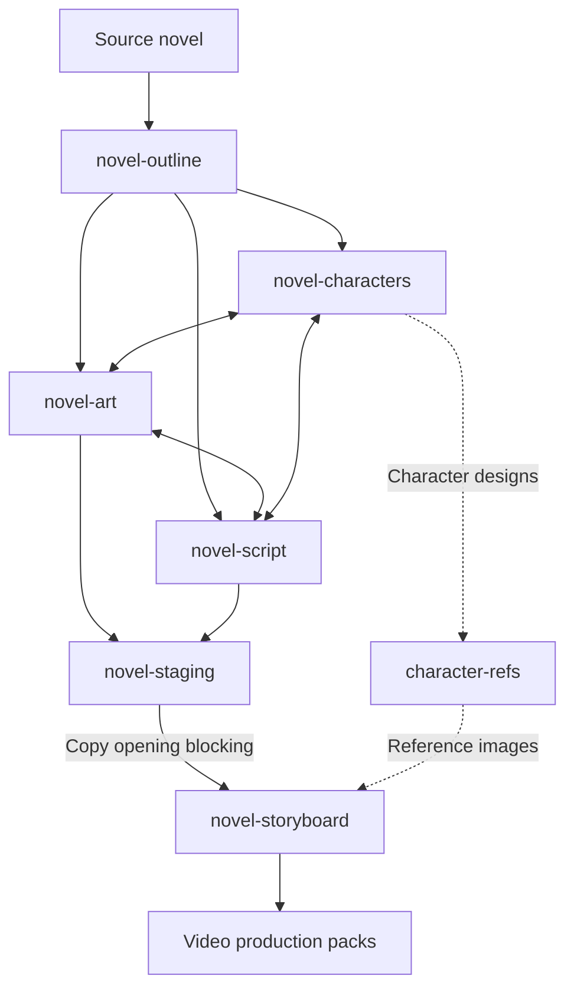

<div align="center">

# shuohao-skills

**面向 AI 短剧制作的与 Agent 无关的技能（skill）**

[English](https://github.com/eternityspring/shuohao-skills/blob/main/README.md) | [中文](README.zh.md) | [X @eternityspring](https://x.com/eternityspring)

**[技能](#技能) · [安装](#安装) · [环境要求](#环境要求) · [仓库约定](#仓库约定)**

</div>

> 👋 **接受工作与合作** — 我目前处于待业状态，这个仓库是我在闲暇时间做的东西。
> 如果它让你产生共鸣，欢迎随时联系我。除了**远程工作**，我也接受**半合作**模式：每月几千元的生活补贴，外加利润分成。确有需要时也可以线下出差。我真正想找的是在这波 AI 浪潮中同频的人，一起做点事情。
> 邮箱：**[eternityspring@gmail.com](mailto:eternityspring@gmail.com)** · 简历：**[resume.79px.com](https://resume.79px.com)** · 微信 **`hao_dev`**（加我时请备注 `github`）
>
> 这些技能免费且开源，在真实的 AI 短剧制作中打磨并经过实战检验。
> 如果它们帮你省下了一个下午，欢迎[**在 Ko-fi 上请我喝杯咖啡**](https://ko-fi.com/eternityspring) ☕ —— 这能让更新持续下去。

## ❤️ 赞助

> [想出现在这里？](mailto:eternityspring@gmail.com)

<details open>
<summary>点击折叠</summary>

<table>
<tr>
<td width="180"><a href="https://go.apimart.ai/tw-shuohao-skills"></a></td>
<td>感谢 <a href="https://go.apimart.ai/tw-shuohao-skills">APIMart</a> 对本项目的赞助！APIMart 是一个低成本的 AI 图像与视频生成 API 平台 —— GPT-Image-2 定价 $0.006/张，一美元可生成 160+ 张图。一个异步 API 同时覆盖图像和视频：提交任务、拿到 ID，再通过轮询或回调获取结果。批量生成数万张图也不会超时，切换模型无需改动代码。按量付费、无月费 —— <a href="https://go.apimart.ai/tw-shuohao-skills">点这里注册</a>即可开始。</td>
</tr>
<tr>
<td width="180"><a href="https://studio.reelbenchai.com"></a></td>
<td><a href="https://studio.reelbenchai.com">Reelbench Studio</a> 是由这些技能的作者开发的付费 AI 视频工作台，以可离线运行的源码形式交付。本地 Codex 负责理解、拆解与编排，自托管的 ComfyUI 负责生成图像和视频，你的素材与项目始终留在自己的机器上。</td>
</tr>
<tr>
<td width="180"></td>
<td>赛博班底 是由这些技能的作者开发的微信小程序：AI 短视频的参考图库，涵盖角色、服装、表情等，支持按分类和标签筛选。每张图都配有一段可一键复制的中文提示词，长按即可保存大图。在微信中扫描左侧二维码即可打开。</td>
</tr>
</table>

</details>

## 技能

**面向 AI 短剧制作的与 Agent 无关的技能** —— 从一本小说到可拍摄素材：角色圣经、改编大纲、场景与道具圣经、剧本、开场调度，以及分镜脚本。每个技能都是自包含的，任何能读取 `SKILL.md` 并运行内置脚本的 Agent 都可以使用；Claude Code 和 Codex 只是两个受支持的例子，并非必需条件。

本仓库目前包含**七个技能：六个制作阶段，外加独立的角色参考图生成**。大纲确定改编结构；角色、美术与剧本并行迭代；调度则在分镜之前确定每个场景的开场位置。



| 技能 | 作用 |
| --- | --- |
| [**novel-outline**](https://github.com/eternityspring/shuohao-skills/blob/main/skills/novel-outline/README.en.md) | 把一本小说改编为五件套短剧大纲：改编说明、演员表、情节点、分集梗概、资产清单（含叙事道具表）。全部 14 道质量门（quality gate）均由脚本校验；并包含针对已有大纲的体检（checkup）模式 |
| [**novel-characters**](https://github.com/eternityspring/shuohao-skills/blob/main/skills/novel-characters/README.en.md) | 把大纲已确定的演员表转化为角色圣经：人物档案、设计提示词、语音提示词、模型设定表。从 outline.json 播种角色名单；报告语言可配置 |
| [**character-refs**](https://github.com/eternityspring/shuohao-skills/blob/main/skills/character-refs/README.en.md) | 为任意故事中的角色**实际生成**参考图（不只是小说 —— 你自己的原创故事同样适用）：用一条消息描述一个角色；它会被拆分为字段、填补空缺并确认，然后生成一张正面全身锚定图，其他所有视角（头部特写、90° 侧面、背面、细节图）只引用这张锚定图，按需分级生成。每张图都有标注、可单独重新生成，并记录过期状态。可对接 Qwen Image（ComfyUI）、codex 图像生成、GPT Image 2 API，或自定义命令 |
| [**novel-art**](https://github.com/eternityspring/shuohao-skills/blob/main/skills/novel-art/README.en.md) | 面向 AI 制作的艺术圣经（场景 + 叙事道具）：一致性锚定图、光照与状态变体、比例参考、无人/无手白底图。从 outline.json 播种；全部 10 道质量门由脚本校验 |
| [**novel-script**](https://github.com/eternityspring/shuohao-skills/blob/main/skills/novel-script/README.en.md) | AI 短剧编剧：场景 + 情节点流动（动作节点与台词行交替），按阅读速度确定性地估算每集时长，在前 3 个节点内设置带门禁的冷开场钩子，附每个角色的台词本与语音提示词，可直接接入 TTS。全部 10 道质量门由脚本校验 |
| [**novel-staging**](https://github.com/eternityspring/shuohao-skills/blob/main/skills/novel-staging/README.en.md) | 依据剧本和场景图规划开场站位：每个角色的座位或站位、朝向、开场存在状态，以及群演。产出 staging.json、一份可编辑的俯视图报告，以及供分镜使用的开场调度语句。全部 8 道质量门由脚本校验 |
| [**novel-storyboard**](https://github.com/eternityspring/shuohao-skills/blob/main/skills/novel-storyboard/README.en.md) | AI 短剧分镜：分段（一次生成，≤15s）→ 切点（2–5s 硬门禁）→ 关键帧（母版钉在 0.00s，子帧钉在各自切点），并做 MiniMax H3 提示词对齐与切点时间逐字审计；画面由技能实际生成，以设计稿作为参考，另有一键生成 H3 / Seedance 制作包。全部 18 道质量门由脚本校验 |

**全部六个流水线技能的报告也都支持英文渲染** —— 报告默认使用中文界面；给 `render` 传入 `--lang en` 可获得全英文报告（数据内容保持原样）。character-refs 同样提供中文、英文和日文界面，并可即时翻译为其他语言。

## 场景调度：输入、输出与交接

`novel-staging` 在剧本之后、分镜之前运行。它读取 `script.json` 获取场景与演员表；`art.json` 提供地点，`outline.json` 提供角色名，场景图则展示可供人物倚靠或落座的物件。剧本是必需的；其余输入只会让结果更好。没有场景图时，依据美术设定推断出的位置会被标记为暂定（provisional）。这些文件可以来自任何制作方，无需安装其他技能。

| 输出 | 提供内容 |
| --- | --- |
| `staging.json` | 每个场景的开场存在状态、锚定物件、侧位、位置、姿态、朝向与群演 |
| `staging.md`（可选） | 文本导出，包含清单、位置表格和开场调度语句 |
| **`staging-report.html`（默认）** | 交互式工具报告，带可拖拽的俯视图和实时校验；可将编辑结果导出回 JSON |
| `blocking` 命令输出 | 每个场景一句开场调度语句，可直接复制到它首个分镜分段中 |

Agent 读取场景图并规划调度；内置的 Node.js 工具负责播种数据、检查八道门、渲染报告并生成调度语句。HTML 工具报告是面向用户的默认产物，可在浏览器中本地打开。JSON 是工作数据；Markdown 仅在需要时生成。要在仓库根目录试用已完成的样例：

```bash
node skills/novel-staging/scripts/novel-staging.mjs validate skills/novel-staging/examples/渡口-staging.json --script skills/novel-staging/references/test-fixtures/upstream/渡口-script.json --art skills/novel-staging/references/test-fixtures/upstream/渡口-art.json
node skills/novel-staging/scripts/novel-staging.mjs render skills/novel-staging/examples/渡口-staging.json --lang en > staging-report.html
node skills/novel-staging/scripts/novel-staging.mjs blocking skills/novel-staging/examples/渡口-staging.json --lang en
```

**分镜目前还不会自动导入 `staging.json`。** 请把已确认的开场调度语句交给 Agent，让它把每一句复制到对应场景的第一个分段中。这个阶段输出的是调度数据和报告；它不生成图像或视频。编写新的调度方案请参阅[技能指南](https://github.com/eternityspring/shuohao-skills/blob/main/skills/novel-staging/README.en.md)。

## 五份阶段报告合并成单页

汇编器目前支持**大纲、角色、美术、剧本和分镜**这五份报告。它不包含调度报告，也不包含 character-refs 图库。这五份受支持的报告可以合并成一个带左侧导航的单页 —— **你实际拥有的每个受支持阶段都会有一个面板**：

```bash
node scripts/report.mjs --from <demo-dir> --out report.html
```

`--from` 会按照[工作目录约定](#仓库约定)自动发现这五个 json 文件；你也可以分别指定（`--outline` `--cast` `--art` `--script` `--storyboard`）。只跑了角色那一遍？你会得到一个面板，不会报错。

它是**一个汇编器，而不是独立的技能**：它不导入任何技能代码，只是以子进程方式调用各技能自身的 `render --html` 并把结果拼接起来。因此这五个技能保持原样，依然可以单独运行，也依然可以单独复制 —— 而且当某个技能改变渲染方式时，这里会自动免费跟上。

合并解决了三个问题，**三个都在汇编器内部解决，不在技能内部解决**：

- **样式串味。** 五份报告共用 57 个类名，其中 13 个在不同报告里含义不同（`.copy`、`.kpis`、`.badge`、`.chip`……），因此每个选择器都加上了作用域前缀
- **脚本串味。** 每份报告的脚本都会做诸如 `document.querySelector('.expo')` 的文档级查找。合并之后，它永远只会找到第一个 —— 五份报告的导出按钮都会失效。因此每个脚本都被包进一层作用域代理
- **资源路径。** 每份报告的图片都是相对于它自己的 json 目录（`images/…`、`E01-01/f1.png`），合并时会基于输出文件重新计算路径

默认一次只显示一个面板（五份合起来约有 60 万字符）。左下角的 "Show all" 会展开全部面板，让 Cmd+F 能检索整个文档。数字键 `1`–`5` 用于切换面板，`#pane-script` 可直接深链到某一份。

```bash
node scripts/report-selftest.mjs   # 92 assertions, no browser needed
```

来自六个制作阶段的报告：

**novel-outline · 短剧改编大纲**


**novel-characters · 角色圣经**


**novel-art · 艺术圣经（场景 + 道具，设定稿由技能实际生成）**


**novel-script · 剧本（时长仪表 + 分集剧本 + 台词本）**


**novel-staging · 开场调度（可拖拽人物的俯视图，然后导出）**


**novel-storyboard · 分镜（切点节奏条 + 由技能实际生成的母版/子关键帧 + H3 提示词）**


这一个不需要小说 —— 适用于任意角色的真实参考图：

**character-refs · 角色参考图（锚定图由 GPT 生成，其余由 Qwen 生成，全部由技能实际生成）**


## 安装

```bash
git clone https://github.com/eternityspring/shuohao-skills.git
cd shuohao-skills
./scripts/install.sh
```

安装脚本目前会检测 Claude Code 和 Codex，并把每个技能以**软链接**方式挂到对应位置 —— 因此 `git pull` 之后立即生效，无需重新安装。技能本身并不绑定这两套运行时。对于其他 Agent，把技能目录复制或软链接到它的 skills 目录，或者直接加载它的 `SKILL.md` 即可。

```bash
./scripts/install.sh novel-characters   # just one skill
./scripts/install.sh --codex            # only into codex
./scripts/install.sh --uninstall        # remove the symlinks
```

更想手动完成：

```bash
AGENT_SKILLS_DIR=/path/to/your-agent/skills
ln -s "$PWD/skills/novel-characters" "$AGENT_SKILLS_DIR/novel-characters"
ln -s "$PWD/skills/novel-characters" ~/.claude/skills/novel-characters
ln -s "$PWD/skills/novel-characters" ~/.codex/skills/novel-characters
```

## 环境要求

| | 是否必需 | 说明 |
| --- | --- | --- |
| **Node** | 是 | ≥ 18。技能脚本只使用标准库 —— **没有 npm 依赖，无需安装任何东西** |
| **模型配额** | 是 | 使用你当前会话的配额。**无需 API key** |
| **Agent 运行时** | 是 | 任何能读取 `SKILL.md` 并运行内置 Node.js 脚本的 Agent。Claude Code 和 Codex 是受支持的例子 |
| **图像模型** | 仅 character-refs 需要 | 以下之一：自建 ComfyUI（Qwen Image）、本地 codex 图像生成（使用你的 ChatGPT 套餐配额）、OpenAI API key（GPT Image 2），或自定义命令。首次使用时选择 |

> **关于输出语言的说明。** 这些技能以中文优先。`novel-characters` 即使面对英文源小说也会产出中文角色档案，它的校验器会主动拒绝这些字段中的英文内容。若要改变这一点，请参阅该技能的 README。

## 仓库约定

每个技能一个目录，**自包含且可单独复制**：

```
skills/<skill-name>/
├── SKILL.md          the workflow the agent reads (required)
├── README.md         the docs a human reads
├── scripts/
│   ├── <name>.mjs    deterministic helpers, zero dependencies
│   └── selftest.mjs  self-test, never calls a model (required)
├── references/       detailed instructions, loaded on demand
├── examples/         bundled samples that double as test fixtures
└── assets/           screenshots
```

两条硬性要求：

- 每个技能都必须有 `SKILL.md`
- 每个技能都必须有 `scripts/selftest.mjs`，**不调用任何模型、不消耗任何配额**，并覆盖全部确定性逻辑

在新增技能之前，先跑一遍所有自测：

```bash
for f in skills/*/scripts/selftest.mjs; do node "$f"; done
```

这里没有 CI —— 自测大约一秒就跑完，因此在本地运行比等待流水线更划算。**仅在 macOS + Node 24 上测试过**；代码中没有平台相关部分，所以 Linux 和更老的 Node 版本应该也没问题，但这尚未验证。


## Star 历史

[](https://star-history.com/#eternityspring/shuohao-skills&Date)


## 许可证

[Apache 2.0](https://github.com/eternityspring/shuohao-skills/blob/main/LICENSE)
